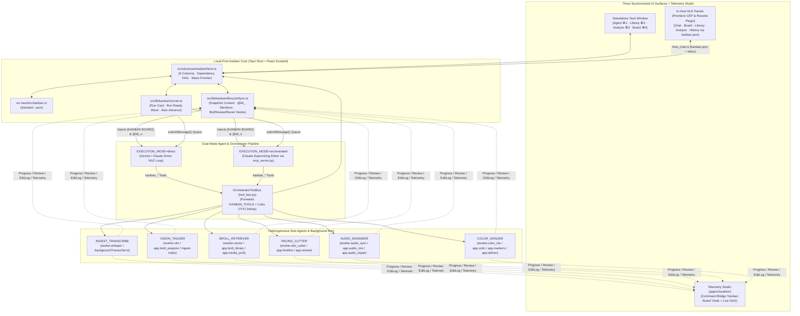
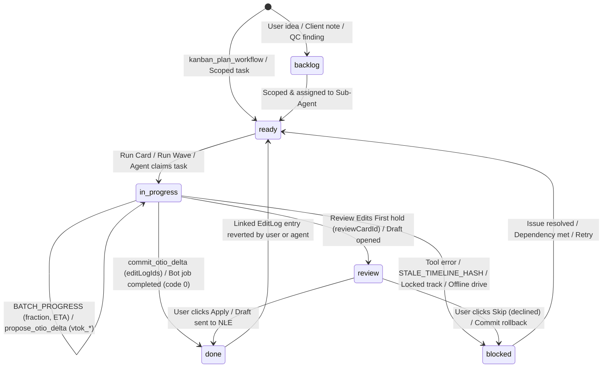

# Architectural Specification & System Design: Agentic Production Kanban System

**Document ID:** `vibecut.kanban.v1`  
**Target Path:** `docs/specs/kanban-spec.md`  
**Status:** Production-Ready Blueprint — Approved for Tactical Implementation via Claude Code CLI  
**Target Branch:** `feat/kanban-orchestrator-board`  
**Design Governance:** Strictly adheres to `AGENTS.md` (§2 Stack Defaults, §3 Dark-Mode Design Tokens, §8 Media Memory Safety, §11 Orchestrated Pipeline Contracts), `CLAUDE.md` (Zero Regression on `EXECUTION_MODE=direct` & `ORCHESTRATOR_SPEC.md` §3 Schema Lock), `ORCHESTRATOR_SPEC.md`, `docs/specs/visualizer-spec.md` (`vibecut.telemetry.v1`), and `docs/specs/host-panels-plan.md` (`vibecut.host.panels.v1`).

---

## 0. Executive Summary & Architectural Mandate

The **VibeCut Agent Kanban System (`vibecut.kanban.v1`)** introduces a local-first, project-scoped, multi-agent **Production Kanban Board** that coordinates complex video editing workflows across the **Master Orchestrator** (Claude via subscription / `mcp_server.py`), the **Direct Editing Agent** (Gemini / Claude), **Heterogeneous Local Sub-Agent Workers** (`WhisperWorker`, `VlmWorker`, `VectorStore`, `GemmaValidator`, Deterministic FFmpeg Core), **Asynchronous Background Bots** (background transcription, bin visual indexing, B-roll folder scoring, waveform sync, multi-take harmonizer, QC/pacing linters, NLE renders), and the **Human Editor**.

Unlike passive project-management boards, every Kanban card in VibeCut Agent is an **executable, timeline-aware work unit** bound to:
1. **A Specialized Sub-Agent Role & Studio Workstation (`SubagentType` + `stationKey`)** matching `packages/contracts/telemetry.ts` and `apps/visualizer/src/lib/studio/stations.ts`.
2. **Exact Timeline & Media Coordinates** (`timeline`, `startSeconds`, `endSeconds`, `clipIds`, `mediaPaths`, and two-way linked NLE `markerId`).
3. **A Dependency DAG (`blockedBy`, `parentCardId`)** enabling the Orchestrator to decompose a multi-stage brief (e.g., *Ingest & Transcribe → Soundbite Assembly → B-Roll Coverage → Audio Ducking & Loudness → Color Match → Final QC*) into ordered waves.
4. **Live Runtime State Hooks** connecting each card to running background sidecar jobs (`activeJobId`, live `%` and `ETA`), pre-flight OTIO delta validation tokens (`validationToken`, `deltaId`), "Review edits first" approval gates (`reviewCardId`), and reversible NLE edit-log entries (`editLogIds`).



### Key Architectural Invariants
1. **Zero Schema Drift on `ORCHESTRATOR_SPEC.md` §3:** `tests/orchestrator/test_schemas.py` parses `ORCHESTRATOR_SPEC.md` §3 verbatim and asserts that `ORCHESTRATOR_TOOLS` contains the exact 6 in-process sidecar tools. Therefore, all Kanban tools (`kanban_list_cards`, `kanban_plan_workflow`, `kanban_create_card`, `kanban_update_card`, `kanban_delete_cards`, `kanban_seed_from_findings`, `kanban_sync_markers`) are implemented as **app-side tools** in `src/lib/agent/kanbanTools.ts` and exposed to `EXECUTION_MODE=orchestrated` via `FORWARDED_TOOLS` in `src-python/vibecut_agent/orchestrator/tool_bus.py` (the exact pattern used for `NOTES_TOOLS`, `BIN_TOOLS`, and `TRANSCRIBE_TOOLS`).
2. **Per-Project Local Persistence:** Boards are stored per `(host, project)` under `<appDataDir>/kanban/<host>-<slug>-<fnv1a>.json` (with a `"global"` workspace fallback when no NLE project is connected) using atomic temp-file writes (`write_atomic`) and `0o700` directory permissions.
3. **Deterministic Runtime Synchronization:** Cards do not rely solely on LLM tool calls to stay accurate. `src/lib/kanban/lifecycleSync.ts` observes `useSidecarStore` (background bot progress/completion), `useAgentStore` (pending/declined/applied review cards), and `useEditLogStore` (committed `editId`s and user/agent reverts) to transition cards deterministically.
4. **Full Three-Surface + Telemetry Studio Parity:** The board is accessible in the main window (`Board` tab `⌘4`), in Premiere Pro and DaVinci Resolve in-host panels (`Board` tab backed by `kanban.json`), and as a dedicated workstation desk (`app.kanban`) in the Telemetry Studio's Command Bridge.

---

## 1. Sub-Agent, Bot & Workstation Mapping Taxonomy

Every Kanban card is assigned to a `KanbanAssignee` pairing a high-level `SubagentType` (or `"HUMAN_EDITOR"`) with a concrete `stationKey` from `apps/visualizer/src/lib/studio/stations.ts` and `src-python/vibecut_agent/telemetry/instrument.py`:

| `SubagentType` / Role | `stationKey` | Station Name | Execution Tier | Primary Tools / Bots Coordinated by Kanban Cards |
| :--- | :--- | :--- | :--- | :--- |
| `MASTER_ORCHESTRATOR` | `orchestrator.supervisor` | **Claude / Supervisor** | Cloud / CLI Supervisor | High-level narrative decomposition (`kanban_plan_workflow`), story assembly (`run_story_editor`). |
| `MASTER_ORCHESTRATOR` | `app.kanban` | **Kanban Board** | App Controller | Workflow planning, wave scheduling, card updates, blocker resolution (`kanban_*`). |
| `MASTER_ORCHESTRATOR` | `app.project` | **Project** | NLE Bridge | `create_timeline`, `duplicate_timeline`, `switch_timeline`, `make_social_version`. |
| `INGEST_TRANSCRIBE` | `worker.whisper` | **Whisper** | Local Metal Sub-Agent | `transcribe_and_align` (`mlx-whisper` / `faster-whisper` word-level timecodes). |
| `INGEST_TRANSCRIBE` | `app.transcripts` | **Transcripts** | Background Sidecar Bot | `transcribe_clips` (`background: true` with pyannote speaker diarization), `find_soundbites`, `find_filler_words`. |
| `VISION_TAGGER` | `worker.vlm` | **Vision Model** | Local Ollama Sub-Agent | `analyze_shot_visuals`, `index_bin_visuals` (`ingest-index` 3-frame contact strips on `qwen3-vl:8b-instruct`). |
| `VISION_TAGGER` | `app.broll_analyzer` | **Analyzer** | Background Sidecar Bot | `analyze_broll_folder`, `analyze_bin` (OpenCV + SigLIP 2 content-aware scoring). |
| `VISION_TAGGER` | `app.thumbnails` | **Thumbnails** | App / Media Bot | `find_thumbnails`, `export_thumbnails`. |
| `BROLL_RETRIEVER` | `worker.vector` | **Vector Index** | Local Vector Sub-Agent | `semantic_asset_search` (`sqlite-vec` + `FTS5` Reciprocal Rank Fusion). |
| `BROLL_RETRIEVER` | `app.broll_library` | **B-roll Library** | Rust / Python Bot | `find_broll`, `build_broll_selects_timeline`, `build_bin_selects` (Spyglass archive). |
| `BROLL_RETRIEVER` | `app.media_pool` | **Bins** | NLE Bridge | `list_media_pool`, `search_media_pool`, `create_bins`, `move_clips`, `set_clip_labels`. |
| `PACING_CUTTER` | `worker.otio_cutter` | **OTIO Cutter** | Local Validator / Compiler | `propose_otio_delta` (`otio_delta.py` deterministic frame compiler + `GemmaValidator`). |
| `PACING_CUTTER` | `app.timeline` | **Timeline** | NLE / Draft Bridge | `set_clip_speed`, `set_speed_ramp`, `set_clip_fade`, `nest_clips`, `close_gaps`, `cut_by_speaker`, `make_split_edit`. |
| `PACING_CUTTER` | `app.review` | **Review & QC** | Media / Vision Critic Bot | `review_edit` (edit lint + vision critic), `check_pacing`, `read_client_notes`, `make_chapters`, `kanban_seed_from_findings`. |
| `PACING_CUTTER` | `app.style` | **Style** | Media Profiler Bot | `learn_style` (reference cut pacing, beat alignment, and color profile). |
| `AUDIO_ENGINEER` | `worker.audio_sync` | **Boundaries** | Deterministic FFmpeg Core | `detect_media_boundaries` (FFmpeg `silencedetect`, `scdet`, EBU R128 loudness). |
| `AUDIO_ENGINEER` | `app.audio_sync` | **Sync** | Rust / Python Bot | `sync_and_place`, `sync_clips`, `slip_into_sync` (`audiosync.rs`), `harmonize_takes`. |
| `AUDIO_ENGINEER` | `app.audio_mix` | **Mix** | Media / NLE Bot | `measure_loudness`, `normalize_loudness`, `find_beats`, `cut_to_beats`, `duck_music`. |
| `AUDIO_ENGINEER` | `app.audio_repair` | **Repair** | FFmpeg Sidecar Bot | `clean_dialogue` (`media-clean`), `fill_room_tone` (`media-roomtone`). |
| `COLOR_GRADER` | `worker.color_nle` | **Editor Link** | Transactional NLE Runner | `commit_otio_delta` (`execute_otio_batch` with atomic backup & rollback). |
| `COLOR_GRADER` | `app.color` | **Colour** | RGB Parade Solver Bot | `set_clip_color`, `match_clip_color`, `balance_clip_color`, `save_color_template`. |
| `COLOR_GRADER` | `app.finishing` | **Transform** | NLE Motion / Fusion | `set_clip_transform`, `get_clip_transform`. |
| `COLOR_GRADER` | `app.titles` | **Titles** | FFmpeg ProRes 4444 / NLE | `add_lower_thirds` (`media-titles`), `create_captions`. |
| `COLOR_GRADER` | `app.markers` | **Markers** | NLE Bridge | `add_markers`, `update_marker`, `remove_markers`, `kanban_sync_markers`. |
| `COLOR_GRADER` | `app.deliver` | **Deliver** | NLE / FFmpeg Render Bot | `export_video`, `export_audio`, `export_clips`. |
| `HUMAN_EDITOR` | `human.editor` | **Human Editor** | Manual NLE Action | Manual creative sign-off, drive mounting, track unlocking, or camera pick decisions. |

---

## 2. Canonical Data Contracts & State Machine (`src/types/kanban.ts`)

Create `src/types/kanban.ts` as the single source of truth shared across the main window (`src/`), the in-host panels (`src-premiere-panel-ui/`), and the tool bus bridge:

```typescript
/**
 * Canonical Data Contracts for the Agentic Production Kanban System (vibecut.kanban.v1).
 * Shared across the Tauri main window (src/), in-host NLE panels (src-premiere-panel-ui/),
 * and agent tool executors (src/lib/agent/kanbanTools.ts).
 */
import type { NleHost } from "./nle";

export const KANBAN_SCHEMA_VERSION = "vibecut.kanban.v1" as const;

export const KANBAN_COLUMNS = [
  "backlog",
  "ready",
  "in_progress",
  "review",
  "done",
  "blocked",
] as const;
export type KanbanColumnId = (typeof KANBAN_COLUMNS)[number];

export const KANBAN_COLUMN_META: Record<
  KanbanColumnId,
  { label: string; shortLabel: string; hint: string }
> = {
  backlog: {
    label: "Backlog",
    shortLabel: "Backlog",
    hint: "Client notes, QC findings, and unscheduled editorial ideas",
  },
  ready: {
    label: "Ready",
    shortLabel: "Ready",
    hint: "Scoped tasks assigned to a sub-agent or bot, ready to execute once dependencies finish",
  },
  in_progress: {
    label: "In Progress",
    shortLabel: "Active",
    hint: "Currently executing in the orchestrator, a local sub-agent worker, or a background bot",
  },
  review: {
    label: "Needs Review",
    shortLabel: "Review",
    hint: "Awaiting user Apply/Skip on an edit review card, a validated OTIO delta, or an open draft",
  },
  done: {
    label: "Done",
    shortLabel: "Done",
    hint: "Committed to the timeline or media cache, linked to reversible Edit Log IDs",
  },
  blocked: {
    label: "Blocked",
    shortLabel: "Blocked",
    hint: "Halted by offline media, locked tracks, stale timeline hash, or a declined review",
  },
};

export const KANBAN_PRIORITIES = ["critical", "high", "medium", "low"] as const;
export type KanbanPriority = (typeof KANBAN_PRIORITIES)[number];

export const KANBAN_CATEGORIES = [
  "ingest",
  "transcript",
  "story",
  "broll",
  "cut",
  "audio",
  "color",
  "gfx",
  "qc",
  "delivery",
] as const;
export type KanbanCategory = (typeof KANBAN_CATEGORIES)[number];

export const KANBAN_SUBAGENT_ROLES = [
  "MASTER_ORCHESTRATOR",
  "INGEST_TRANSCRIBE",
  "VISION_TAGGER",
  "BROLL_RETRIEVER",
  "PACING_CUTTER",
  "AUDIO_ENGINEER",
  "COLOR_GRADER",
  "HUMAN_EDITOR",
] as const;
export type KanbanAssigneeRole = (typeof KANBAN_SUBAGENT_ROLES)[number];

export interface KanbanAssignee {
  /** High-level SubagentType role (or HUMAN_EDITOR). */
  role: KanbanAssigneeRole;
  /** Workstation key from apps/visualizer/src/lib/studio/stations.ts (e.g. "worker.whisper", "worker.otio_cutter"). */
  stationKey: string;
  /** Human-readable badge title (e.g. "Whisper", "Vision Model", "OTIO Cutter", "Audio Mix"). */
  label: string;
}

export interface KanbanTimelineContext {
  /** Target sequence/timeline name in Premiere Pro or DaVinci Resolve. */
  timeline: string | null;
  /** Optional start position in timeline seconds (clickable to move NLE playhead). */
  startSeconds: number | null;
  /** Optional end position in timeline seconds. */
  endSeconds: number | null;
  /** Target track labels (e.g. ["V1", "A1"]). */
  tracks: string[];
  /** Referenced timeline clip IDs or short media pool aliases (e.g. ["p1", "p2"]). */
  clipIds: string[];
  /** Referenced source media paths on disk. */
  mediaPaths: string[];
  /** Linked NLE timeline marker ID when two-way marker sync is active. */
  markerId: string | null;
}

export interface KanbanJobProgress {
  /** 0..1 progress fraction, or null when indeterminate. */
  fraction: number | null;
  /** Current execution phase or detail line. */
  phase: string | null;
  /** Estimated seconds remaining, or null. */
  etaSeconds: number | null;
}

export interface KanbanCardExecution {
  /** How this card is executed when triggered from the board. */
  mode: "agent_turn" | "background_bot" | "manual";
  /** Optional executable instruction or prompt sent to the agent when "Run" is clicked. */
  autoPrompt: string | null;
  /** Running sidecar job ID (e.g. transcribe, ingest-index, broll-analyze) or active chat step ID. */
  activeJobId: string | null;
  /** Linked Telemetry Studio trace ID (e.g. "trc_mcp_...", "trc_trn_..."). */
  traceId: string | null;
  /** Live progress from useSidecarStore while a background bot is running on this card. */
  progress: KanbanJobProgress | null;
  /** Cryptographic vtok_* token from a passing propose_otio_delta call. */
  validationToken: string | null;
  /** Associated OtioDeltaPayload delta_id. */
  deltaId: string | null;
  /** Chat message ID of a pending "Review edits first" tool card waiting for Apply or Skip. */
  reviewCardId: string | null;
  /** Edit log entry IDs (e.g. ["e401", "e402"]) produced when this card was committed. */
  editLogIds: string[];
  /** Output artifact summaries or file paths (e.g. ".otio" snapshot, transcript cache, rendered MP4). */
  artifacts: string[];
  /** Diagnostic message explaining why the card entered "blocked". */
  blockedReason: string | null;
}

export interface KanbanChecklistItem {
  id: string;
  text: string;
  done: boolean;
}

export type KanbanCardOrigin =
  | "user"
  | "orchestrator"
  | "subagent"
  | "bot"
  | "client_notes"
  | "qc_lint";

export interface KanbanCard {
  /** Short, human- and LLM-friendly ID within the board: "kb_1", "kb_2", ... */
  id: string;
  title: string;
  description: string;
  column: KanbanColumnId;
  priority: KanbanPriority;
  category: KanbanCategory;
  assignee: KanbanAssignee;
  timelineContext: KanbanTimelineContext;
  /** IDs of upstream cards (e.g. ["kb_1"]) that must reach "done" before this card can run. */
  blockedBy: string[];
  /** Optional parent epic card ID when decomposed by kanban_plan_workflow. */
  parentCardId: string | null;
  checklist: KanbanChecklistItem[];
  execution: KanbanCardExecution;
  createdBy: KanbanCardOrigin;
  createdAt: number;
  updatedAt: number;
  completedAt: number | null;
}

export interface KanbanBoardFile {
  schemaVersion: typeof KANBAN_SCHEMA_VERSION;
  host: NleHost | "global";
  project: string;
  /** Monotonically increasing sequence counter for assigning "kb_<n>" IDs; never decrements. */
  nextCardSeq: number;
  /** When true, finishing a background bot or wave step automatically queues the next unblocked Ready card. */
  autoAdvanceWave: boolean;
  updatedAt: number;
  cards: KanbanCard[];
}
```

### 2.1 Default Category-to-Subagent Assignment Helper (`DEFAULT_CATEGORY_ASSIGNEE`)

When a user or tool creates a card with a `category` and omits an explicit `assignee`, the board assigns the canonical sub-agent and studio workstation:

| `category` | Default `assignee.role` | Default `assignee.stationKey` | Default `assignee.label` |
| :--- | :--- | :--- | :--- |
| `"ingest"` | `"VISION_TAGGER"` | `"worker.vlm"` | `"Vision Ingest"` |
| `"transcript"` | `"INGEST_TRANSCRIBE"` | `"worker.whisper"` | `"Whisper STT"` |
| `"story"` | `"MASTER_ORCHESTRATOR"` | `"orchestrator.supervisor"` | `"Story Supervisor"` |
| `"broll"` | `"BROLL_RETRIEVER"` | `"worker.vector"` | `"B-Roll Retriever"` |
| `"cut"` | `"PACING_CUTTER"` | `"worker.otio_cutter"` | `"OTIO Cutter"` |
| `"audio"` | `"AUDIO_ENGINEER"` | `"app.audio_mix"` | `"Audio Engineer"` |
| `"color"` | `"COLOR_GRADER"` | `"app.color"` | `"Colour Grader"` |
| `"gfx"` | `"COLOR_GRADER"` | `"app.titles"` | `"Titles & Captions"` |
| `"qc"` | `"PACING_CUTTER"` | `"app.review"` | `"Review & QC"` |
| `"delivery"` | `"COLOR_GRADER"` | `"app.deliver"` | `"Deliver & Export"` |

### 2.2 Card Lifecycle State Machine



---

## 3. Rust Persistence & Host-Panel Bridge (`src-tauri/src/kanban.rs` & `src-tauri/src/host_chat.rs`)

### 3.1 Per-Project Atomic Kanban Storage (`src-tauri/src/kanban.rs`)

Create `src-tauri/src/kanban.rs` mirroring `src-tauri/src/project_notes.rs`. Each NLE project gets an isolated JSON board file in `<appDataDir>/kanban/<host>-<slug>-<fnv1a>.json` (and `<appDataDir>/kanban/global-workspace.json` when `host == "global"` or no NLE project is open).

```rust
//! Project Kanban boards (`vibecut.kanban.v1`, docs/specs/kanban-spec.md): persistent, per-project
//! task boards coordinating the supervising editor, direct editing agent, local sub-agents, and
//! background bots. Stored as one atomic JSON file per editor project in `<appDataDir>/kanban/`.

use crate::broll_panel::write_atomic;
use serde_json::Value;
use std::path::{Path, PathBuf};
use std::sync::Mutex;
use tauri::{AppHandle, Manager};

/// Maximum serialized board size (512 KiB): sufficient for hundreds of cards with checklists.
pub const MAX_KANBAN_BYTES: usize = 512 * 1024;
const HOSTS: &[&str] = &["premiere", "resolve", "global"];

static LOCK: Mutex<()> = Mutex::new(());

pub fn kanban_dir(app: &AppHandle) -> Result<PathBuf, String> {
    app.path()
        .app_data_dir()
        .map(|d| d.join("kanban"))
        .map_err(|_| "The app's data folder is unavailable".to_string())
}

/// FNV-1a 64-bit hash: deterministic across processes and builds.
fn fnv1a(text: &str) -> u64 {
    text.bytes().fold(0xcbf2_9ce4_8422_2325, |hash, byte| {
        (hash ^ u64::from(byte)).wrapping_mul(0x0100_0000_01b3)
    })
}

/// `resolve-my-doc-1a2b3c4d5e6f7a8b.json` for Resolve's "My Doc", or `global-workspace.json` when no
/// editor project is open.
pub fn file_name(host: &str, project: &str) -> Result<String, String> {
    if !HOSTS.contains(&host) {
        return Err(format!("{host} isn't an editor VibeCut Agent knows"));
    }
    if host == "global" {
        return Ok("global-workspace.json".into());
    }
    let project = project.trim();
    if project.is_empty() || project.len() > 512 {
        return Err("The project needs a name".into());
    }
    let mut slug = String::new();
    for c in project.chars().flat_map(char::to_lowercase) {
        if c.is_ascii_alphanumeric() {
            slug.push(c);
        } else if !slug.ends_with('-') {
            slug.push('-');
        }
        if slug.len() >= 40 {
            break;
        }
    }
    let slug = slug.trim_matches('-');
    Ok(format!(
        "{host}-{}{:016x}.json",
        if slug.is_empty() {
            String::new()
        } else {
            format!("{slug}-")
        },
        fnv1a(&format!("{host}\n{project}"))
    ))
}

pub fn load_in(dir: &Path, host: &str, project: &str) -> Result<Option<Value>, String> {
    let path = dir.join(file_name(host, project)?);
    match std::fs::read_to_string(&path) {
        Ok(text) => serde_json::from_str::<Value>(&text)
            .map(Some)
            .map_err(|e| format!("Couldn't parse the project's Kanban board: {e}")),
        Err(e) if e.kind() == std::io::ErrorKind::NotFound => Ok(None),
        Err(e) => Err(format!("Couldn't read the project's Kanban board: {e}")),
    }
}

/// Saves the board JSON atomically; an empty cards array with `nextCardSeq <= 1` removes the file.
pub fn save_in(dir: &Path, host: &str, project: &str, board: &Value) -> Result<(), String> {
    let name = file_name(host, project)?;
    let Value::Object(map) = board else {
        return Err("Kanban board must be a JSON object".into());
    };
    if map.get("schemaVersion").and_then(Value::as_str) != Some("vibecut.kanban.v1") {
        return Err("Kanban board schemaVersion must be \"vibecut.kanban.v1\"".into());
    }
    let Some(Value::Array(cards)) = map.get("cards") else {
        return Err("Kanban board must contain a cards array".into());
    };
    let bytes = serde_json::to_vec_pretty(board)
        .map_err(|e| format!("Couldn't serialize the Kanban board: {e}"))?;
    if bytes.len() > MAX_KANBAN_BYTES {
        return Err(format!(
            "Kanban board can hold at most {} KB; archive or delete completed cards first",
            MAX_KANBAN_BYTES / 1024
        ));
    }
    let _guard = LOCK.lock().unwrap_or_else(|p| p.into_inner());
    let next_seq = map.get("nextCardSeq").and_then(Value::as_u64).unwrap_or(1);
    if cards.is_empty() && next_seq <= 1 {
        return match std::fs::remove_file(dir.join(&name)) {
            Err(e) if e.kind() != std::io::ErrorKind::NotFound => {
                Err(format!("Couldn't clear the project's Kanban board: {e}"))
            }
            _ => Ok(()),
        };
    }
    std::fs::create_dir_all(dir).map_err(|e| format!("Couldn't make {}: {e}", dir.display()))?;
    #[cfg(unix)]
    {
        use std::os::unix::fs::PermissionsExt;
        let _ = std::fs::set_permissions(dir, std::fs::Permissions::from_mode(0o700));
    }
    write_atomic(dir, &name, &bytes)
}

#[tauri::command]
pub async fn kanban_board_get(
    app: AppHandle,
    host: String,
    project: String,
) -> Result<Option<Value>, String> {
    load_in(&kanban_dir(&app)?, &host, &project)
}

#[tauri::command]
pub async fn kanban_board_set(
    app: AppHandle,
    host: String,
    project: String,
    board: Value,
) -> Result<(), String> {
    save_in(&kanban_dir(&app)?, &host, &project, &board)
}
```

### 3.2 Tray, View & Host-Chat Bridge Extensions (`src-tauri/src/state.rs`, `tray.rs`, `host_chat.rs`, `lib.rs`)

1. **`src-tauri/src/state.rs` & `src/types/system.ts`:**
   - Add `Kanban` to `pub enum View` in `src-tauri/src/state.rs`:
     ```rust
     pub enum View {
         Chat,
         Library,
         Broll,
         Kanban,
         Settings,
         About,
     }
     ```
   - Mirror in `src/types/system.ts`:
     ```typescript
     export type View = "chat" | "library" | "broll" | "kanban" | "settings" | "about";
     ```
2. **`src-tauri/src/tray.rs`:**
   - Add `const ID_KANBAN: &str = "tray-kanban";`
   - Map `ID_KANBAN => Some(View::Kanban)` in `view_for_menu_id`.
   - Add `MenuItem::with_id(handle, ID_KANBAN, "Open Kanban Board", true, None::<&str>)?` right below `Open B-Roll Analyzer` in the tray menu.
3. **`src-tauri/src/host_chat.rs`:**
   - Add `"kanban"` to `WINDOW_VIEWS`:
     ```rust
     const WINDOW_VIEWS: [&str; 5] = ["chat", "library", "broll", "kanban", "visualizer"];
     ```
     and map `"kanban" => View::Kanban` in `open_window`.
   - Add `#[tauri::command] pub fn host_chat_kanban_publish(host: Host, file: Value) -> Result<bool, String>` calling `publish_in(&host_dir(host)?, "kanban.json", &file)`.
   - Extend `validate_action` in `src-tauri/src/host_chat.rs` with the allow-listed Kanban actions from in-host panels:
     - `"kanban_move"`: `{ cardId: id_field(action, "cardId")?, column: one_of(action, "column", &["backlog", "ready", "in_progress", "review", "done", "blocked"])? }`
     - `"kanban_run"`: `{ cardId: id_field(action, "cardId")? }`
     - `"kanban_delete"`: `{ cardId: id_field(action, "cardId")? }`
     - `"kanban_toggle_check"`: `{ cardId: id_field(action, "cardId")?, checkId: id_field(action, "checkId")? }`
     - `"kanban_create"`: `{ title: text_field(action)?, category: one_of(action, "category", &["ingest", "transcript", "story", "broll", "cut", "audio", "color", "gfx", "qc", "delivery"])?, priority: one_of(action, "priority", &["critical", "high", "medium", "low"])?, column: one_of(action, "column", &["backlog", "ready"])? }`
     - `"kanban_seed_qc"`: `{ source: one_of(action, "source", &["review", "pacing", "markers"])? }`
     - Zero-field actions: `"kanban_run_wave" | "kanban_clear_done" | "kanban_sync_markers" | "kanban_toggle_auto_wave"`
4. **`src-tauri/src/lib.rs`:**
   - Add `mod kanban;` and register `kanban::kanban_board_get`, `kanban::kanban_board_set`, and `host_chat::host_chat_kanban_publish` in `tauri::generate_handler![...]`.

---

## 4. Frontend Store, Lifecycle Synchronizer & Wave Runner (`src/store/useKanbanStore.ts` & `src/lib/kanban/`)

### 4.1 Zustand Board Store (`src/store/useKanbanStore.ts`)

Create `src/store/useKanbanStore.ts` managing the active board and persisting mutations atomically through `kanban_board_get` / `kanban_board_set`:

- **Project Resolution (`activeBoardScope`):**
  - Reads `selectActiveHost(useNleStateStore.getState())` and that host's `project`.
  - When a host and project are present (e.g. `("resolve", "VibeCut 7a")`), loads `<appDataDir>/kanban/resolve-vibecut-7a-<hash>.json`.
  - When no editor or project is open, falls back to `("global", "Workspace")` (`global-workspace.json`), so the user and agent can plan tasks even before opening Premiere or Resolve.
- **Core Store Actions:**
  - `loadForActiveProject()`: Loads the board for the current `(host, project)` scope (creating a fresh empty `KanbanBoardFile` with `nextCardSeq: 1` in memory if `kanban_board_get` returns `null`).
  - `createCard(input)`: Assigns `id = "kb_" + board.nextCardSeq`, increments `nextCardSeq`, resolves default `assignee` from `DEFAULT_CATEGORY_ASSIGNEE[category]` if omitted, appends the card, and persists.
  - `planWorkflow(cardsInput, options)`: Batch-creates a dependency-linked set of cards in one atomic write, mapping caller-supplied temporary IDs (e.g. `"step_1"`, `"step_2"`) in `blockedBy` and `parentCardId` to their newly minted `"kb_<n>"` IDs.
  - `updateCard(cardId, patch)`: Updates any mutable fields (`title`, `description`, `column`, `priority`, `category`, `assignee`, `timelineContext`, `blockedBy`, `checklist`, `execution`), sets `completedAt = Date.now()` when transitioning into `"done"` (or clears `completedAt` when leaving `"done"`), and persists.
  - `toggleChecklistItem(cardId, checkId)`: Flips a checklist item's `done` boolean.
  - `deleteCards(cardIds)` / `clearDoneCards()`: Removes specified cards (or all `"done"` cards) and cleans dangling references from remaining cards' `blockedBy` arrays.
  - `setAutoAdvanceWave(on)`: Toggles `autoAdvanceWave`.
  - `activeTurnCardId: string | null`: Tracks the card currently being executed by the active chat turn so OTIO deltas, review cards, and edit-log entries automatically bind to it.

### 4.2 Topological Readiness & Dependency Resolution (`src/lib/kanban/dag.ts`)

Create `src/lib/kanban/dag.ts` with pure, unit-tested DAG utilities:

1. **`unresolvedBlockers(card: KanbanCard, allCards: readonly KanbanCard[]): KanbanCard[]`**:
   - Returns all cards referenced in `card.blockedBy` that still exist on the board and whose `column !== "done"`.
2. **`isCardExecutable(card: KanbanCard, allCards: readonly KanbanCard[]): boolean`**:
   - True when `card.column === "ready"` and `unresolvedBlockers(card, allCards).length === 0`.
3. **`readyWaveFrontier(allCards: readonly KanbanCard[]): KanbanCard[]`**:
   - Returns all executable `"ready"` cards sorted by `PRIORITY_RANK` (`critical: 0`, `high: 1`, `medium: 2`, `low: 3`), then by `createdAt` ascending.
4. **`detectCycle(cards: readonly { id: string; blockedBy: string[] }[]): string[] | null`**:
   - Standard 3-color DFS cycle detector invoked by `kanban_plan_workflow` and `kanban_update_card` to reject circular `blockedBy` dependencies with a clear error message.

### 4.3 Deterministic Runtime Lifecycle Synchronizer (`src/lib/kanban/lifecycleSync.ts`)

Create `src/lib/kanban/lifecycleSync.ts` and mount `startKanbanSync()` in `src/App.tsx`:

1. **NLE Project Switch Listener:**
   - Subscribes to `useNleStateStore`; whenever the active `(host, project)` changes, calls `useKanbanStore.getState().loadForActiveProject()`.
2. **Sidecar Background Bot Progress & Completion Sync:**
   - Subscribes to `useSidecarStore`. For any card whose `execution.activeJobId` matches a job in `useSidecarStore.getState().jobs`:
     - While `job.status === "starting" || job.status === "running"`, updates `card.execution.progress = { fraction: job.fraction, phase: job.detail ?? job.phase, etaSeconds: etaSeconds(job, Date.now()) }` and keeps `card.column = "in_progress"`.
     - When `job.status === "done"`, moves `card.column = "done"`, clears `activeJobId` and `progress`, appends a summary artifact, and if `board.autoAdvanceWave` is true, triggers `advanceWaveIfIdle()`.
     - When `job.status === "error" || job.status === "cancelled"`, moves `card.column = "blocked"`, clears `activeJobId` and `progress`, and sets `card.execution.blockedReason = job.error ?? "Background job was cancelled"`.
3. **Review Gate ("Review edits first") & Tool Execution Sync:**
   - When `runChatTool` in `src/lib/agent/controller.ts` creates a pending review card (`state === "pending"`) while a Kanban card is active (`activeTurnCardId` or referenced by `[kb_<n>]` in the commit summary):
     - Moves that Kanban card to `"review"` and sets `card.execution.reviewCardId = reviewMessageId`.
     - If the user clicks **Skip** (`state === "declined"`), moves the Kanban card to `"blocked"` with `blockedReason = "Declined during edit review"`.
     - Clicking **Apply** or **Skip** on the Kanban card itself invokes `answerReview(card.execution.reviewCardId, decision)` from `src/lib/agent/review.ts`.
4. **Edit Log Commit & Revert Sync:**
   - Subscribes to `useEditLogStore`:
     - When a new `EditLogEntry` is logged during a turn bound to `activeTurnCardId` (or whose `summary` / `stepText` contains `[kb_<n>]` or `@kb_<n>`), appends `entry.id` to `card.execution.editLogIds`.
     - When one or more `EditLogEntry` records transition to `reverted: true`, checks every `"done"` card that has non-empty `execution.editLogIds`: if **all** of that card's `editLogIds` are now marked `reverted: true` in `useEditLogStore`, transitions the card from `"done"` back to `"ready"` (clearing `completedAt` and setting `execution.blockedReason = null`), so a reverted edit is immediately ready to be re-cut!
5. **Snapshot Context Injection (`kanbanContext` in `src/lib/agent/context.ts`):**
   - In `snapshotFor(host, timeline)` (`src/lib/agent/context.ts`), right after `notesContext`, include `kanbanContext(board)`:
     - If the board has no cards, emits:
       `[KANBAN BOARD for "<project>": empty. Use kanban_plan_workflow to decompose multi-step edits into sub-agent cards, or kanban_create_card / kanban_seed_from_findings to track tasks.]`
     - Otherwise formats a compact, structured summary (capped at 2,400 chars) listing column counts and active cards (`in_progress`, `review`, `blocked`, `ready`, and up to 5 `backlog` / 3 recent `done` cards):
       ```text
       [KANBAN BOARD for "VibeCut 7a" (2 ready, 1 in_progress, 1 review, 0 blocked, 3 done)]
       - kb_4 [IN_PROGRESS | high | cut | OTIO Cutter (worker.otio_cutter)] "Tighten Grady A-roll pauses" (tl: Main 00:15–01:45)
       - kb_3 [REVIEW | high | broll | Editor Link (worker.color_nle)] "Place lab B-roll over jump cuts" (waiting review, vtok_8f3a...)
       - kb_5 [READY | medium | audio | Audio Engineer (app.audio_mix)] "Duck music bed -12 dB & normalize to -14 LUFS" (blockedBy: kb_4)
       - kb_6 [READY | medium | color | Colour Grader (app.color)] "Match B-cam parade to A-cam" (blockedBy: kb_3)
       [END KANBAN BOARD]
       ```
6. **`@-Mentions` Integration (`src/lib/agent/mentions.ts` & `src/types/agent.ts`):**
   - Add `"card"` to `MentionKind` in `src/types/agent.ts`:
     `export type MentionKind = "timeline" | "clip" | "marker" | "media" | "speaker" | "shot" | "card";`
   - Add `{ kind: "card", label: "Board" }` to `MENTION_GROUPS` in `src/lib/agent/mentions.ts`.
   - In `allMentions()`, emit each non-archived card from `useKanbanStore.getState().board.cards`:
     `{ kind: "card", label: `${card.id} ${card.title}`, ref: card.id, detail: `${KANBAN_COLUMN_META[card.column].shortLabel} · ${card.assignee.label}` }`
   - In `KIND_WORD`, map `card: "kanban card"`.

### 4.4 Board Execution Engine (`src/lib/kanban/runner.ts`)

Create `src/lib/kanban/runner.ts` to execute individual cards or dependency-resolved waves:

```typescript
/**
 * Dispatches a single Kanban card or a topological wave of unblocked "ready" cards to the
 * editing agent / orchestrator or background bots.
 */
import { submitMessage } from "../agent/controller";
import { useAgentStore } from "../../store/useAgentStore";
import { useKanbanStore } from "../../store/useKanbanStore";
import type { KanbanCard } from "../../types/kanban";
import { clock } from "../agent/args";
import { isCardExecutable, readyWaveFrontier, unresolvedBlockers } from "./dag";

export function buildCardExecutionPrompt(card: KanbanCard): string {
  const scopeParts: string[] = [];
  const ctx = card.timelineContext;
  if (ctx.timeline) scopeParts.push(`timeline "${ctx.timeline}"`);
  if (ctx.startSeconds !== null && ctx.endSeconds !== null) {
    scopeParts.push(`range ${clock(ctx.startSeconds)}–${clock(ctx.endSeconds)}`);
  } else if (ctx.startSeconds !== null) {
    scopeParts.push(`at ${clock(ctx.startSeconds)}`);
  }
  if (ctx.tracks.length) scopeParts.push(`tracks ${ctx.tracks.join(", ")}`);
  if (ctx.clipIds.length) scopeParts.push(`clips ${ctx.clipIds.join(", ")}`);
  if (ctx.mediaPaths.length) scopeParts.push(`files ${ctx.mediaPaths.join(", ")}`);
  const checklistLines = card.checklist
    .filter((item) => !item.done)
    .map((item) => `  - [ ] ${item.text}`)
    .join("\n");

  const instructions = card.execution.autoPrompt?.trim() || card.description.trim() || card.title;
  return [
    `[Kanban Task ${card.id}] Execute card ${card.id} ("${card.title}") assigned to ${card.assignee.label} (${card.assignee.role} / ${card.assignee.stationKey}).`,
    scopeParts.length ? `Target scope: ${scopeParts.join(" · ")}.` : null,
    `Instructions: ${instructions}`,
    checklistLines ? `Remaining checklist:\n${checklistLines}` : null,
    `When you start, keep ${card.id} in "in_progress"; when finished, call kanban_update_card to move ${card.id} to "done" (or "blocked" with blockedReason if halted).`,
  ]
    .filter(Boolean)
    .join("\n");
}

export async function runKanbanCard(cardId: string): Promise<{ ok: boolean; message: string }> {
  const store = useKanbanStore.getState();
  const card = store.board.cards.find((c) => c.id === cardId);
  if (!card) return { ok: false, message: `Card ${cardId} isn't on the board` };
  const blockers = unresolvedBlockers(card, store.board.cards);
  if (blockers.length > 0) {
    return {
      ok: false,
      message: `${card.id} is waiting on ${blockers.map((b) => `${b.id} ("${b.title}")`).join(", ")}`,
    };
  }
  store.setActiveTurnCardId(card.id);
  await store.updateCard(card.id, {
    column: "in_progress",
    execution: { ...card.execution, blockedReason: null },
  });
  const prompt = buildCardExecutionPrompt(card);
  const outcome = await submitMessage(prompt, [], [
    {
      kind: "card",
      label: `${card.id} ${card.title}`,
      ref: card.id,
      detail: `${card.assignee.label}`,
    },
  ]);
  if (!outcome) {
    store.setActiveTurnCardId(null);
    return { ok: false, message: "The agent is offline or its queue is full" };
  }
  return {
    ok: true,
    message:
      outcome === "queued"
        ? `Queued ${card.id} ("${card.title}")`
        : `Started ${card.id} ("${card.title}") with ${card.assignee.label}`,
  };
}

export async function runReadyWave(): Promise<{ started: string[]; message: string }> {
  const store = useKanbanStore.getState();
  const frontier = readyWaveFrontier(store.board.cards);
  if (frontier.length === 0) {
    const readyCount = store.board.cards.filter((c) => c.column === "ready").length;
    return {
      started: [],
      message:
        readyCount > 0
          ? `All ${readyCount} Ready card(s) are waiting on upstream dependencies`
          : "No cards are in the Ready column",
    };
  }
  const started: string[] = [];
  for (const card of frontier) {
    if (!isCardExecutable(card, useKanbanStore.getState().board.cards)) continue;
    const res = await runKanbanCard(card.id);
    if (res.ok) started.push(card.id);
    else break;
  }
  return {
    started,
    message: started.length
      ? `Dispatched wave of ${started.length} card(s): ${started.join(", ")}`
      : "Couldn't dispatch the wave (check if the agent is online)",
  };
}
```

---

## 5. Agent & Orchestrator Tool Bus Integration

### 5.1 App-Side Kanban Tools (`src/lib/agent/kanbanTools.ts`)

Create `src/lib/agent/kanbanTools.ts` providing 7 structured tools available in both `EXECUTION_MODE=direct` and `EXECUTION_MODE=orchestrated`:

1. **`kanban_list_cards`**:
   - **Parameters:** `column?: KanbanColumnId`, `category?: KanbanCategory`, `assigneeRole?: KanbanAssigneeRole`, `includeDone?: boolean` (default `true`).
   - **Behavior:** Returns the current project's board metadata, column counts, unblocked wave frontier IDs, and matching cards.
2. **`kanban_plan_workflow`**:
   - **Parameters:**
     - `clearExistingReadyAndBacklog?: boolean` (default `false`)
     - `autoAdvanceWave?: boolean` (default `false`)
     - `cards`: non-empty array (1..30) of `{ tempId?: string, title: string, description?: string, category: KanbanCategory, priority?: KanbanPriority, column?: "backlog" | "ready" | "in_progress", assigneeRole?: KanbanAssigneeRole, stationKey?: string, timeline?: string, startSeconds?: number, endSeconds?: number, tracks?: string[], clipIds?: string[], mediaPaths?: string[], blockedBy?: string[], parentTempId?: string, checklist?: string[], autoPrompt?: string }`
   - **Behavior:** Validates that `blockedBy` contains no cycles (`detectCycle`), resolves each card's `tempId` (e.g. `"t1"`, `"t2"`) to its newly allocated `"kb_<n>"` ID (while also allowing references to existing `"kb_<n>"` IDs on the board), assigns default sub-agent stations from `DEFAULT_CATEGORY_ASSIGNEE` when `assigneeRole` / `stationKey` are omitted, writes the batch atomically, and returns the created cards with the initial unblocked wave frontier.
3. **`kanban_create_card`**:
   - **Parameters:** `title: string`, `description?: string`, `category: KanbanCategory`, `priority?: KanbanPriority` (default `"medium"`), `column?: KanbanColumnId` (default `"ready"`), `assigneeRole?: KanbanAssigneeRole`, `stationKey?: string`, `timeline?: string`, `startSeconds?: number`, `endSeconds?: number`, `tracks?: string[]`, `clipIds?: string[]`, `mediaPaths?: string[]`, `blockedBy?: string[]`, `checklist?: string[]`, `autoPrompt?: string`.
   - **Behavior:** Creates a single card on the project's Kanban board and returns its `"kb_<n>"` ID.
4. **`kanban_update_card`**:
   - **Parameters:** `cardId: string`, `column?: KanbanColumnId`, `title?: string`, `description?: string`, `priority?: KanbanPriority`, `category?: KanbanCategory`, `assigneeRole?: KanbanAssigneeRole`, `stationKey?: string`, `blockedBy?: string[]`, `blockedReason?: string`, `checkItemsDone?: string[]` (checklist item IDs or exact texts to mark done), `editLogIds?: string[]`, `artifacts?: string[]`, `validationToken?: string`, `deltaId?: string`.
   - **Behavior:** Updates the card, binds `activeTurnCardId` when `column === "in_progress"`, clears `activeTurnCardId` when `column === "done" || column === "blocked"`, and reports any downstream cards that just became unblocked when `column === "done"`.
5. **`kanban_delete_cards`**:
   - **Parameters:** `cardIds?: string[]`, `clearDone?: boolean`.
   - **Behavior:** Deletes the specified cards (or all `"done"` cards when `clearDone: true`) and removes their IDs from remaining cards' `blockedBy` lists.
6. **`kanban_seed_from_findings`**:
   - **Parameters:**
     - `source`: `"review_edit" | "check_pacing" | "client_notes"`
     - `notesText?: string` (optional pasted client notes when `source === "client_notes"`; otherwise reads timeline markers)
     - `targetColumn?: "backlog" | "ready"` (default `"ready"`)
     - `syncMarkers?: boolean` (default `false`; when true, stamps NLE markers for created cards)
   - **Behavior:** Runs the corresponding analyzer/reader (`reviewExecutors(context).review_edit`, `pacingExecutors(context).check_pacing`, or `clientNotesExecutors(context).read_client_notes`), deduplicates against existing cards on the board by `(title, startSeconds)`, and creates timecode-linked Kanban cards automatically assigned to the right sub-agent (`AUDIO_ENGINEER` for loudness/dead-air/silence, `COLOR_GRADER` for flash frames/offline/transform, `PACING_CUTTER` for long shots/slow stretches, `BROLL_RETRIEVER` for B-roll requests).
7. **`kanban_sync_markers`**:
   - **Parameters:** `direction?: "board_to_timeline" | "timeline_to_board" | "both"` (default `"both"`), `includeDone?: boolean` (default `false`).
   - **Behavior:**
     - `board_to_timeline`: For each Kanban card with a finite `timelineContext.startSeconds` on the open timeline, adds or updates an NLE marker named `"[kb_n] <title>"` (or `"✓ [kb_n] <title>"` when `column === "done"`) with status-mapped marker colors (`Yellow` for `backlog`/`ready`, `Cyan` for `in_progress`, `Purple` for `review`, `Red` for `blocked`, `Green` for `done`).
     - `timeline_to_board`: Reads `list_markers` from the open timeline; any marker whose name starts with `"TODO:"`, `"NOTE:"`, `"FIX:"`, or `"[kb_]"` that does not yet have a card is imported into `"backlog"` or updates its linked card (`"✓ "` prefix marks the card `"done"`).

### 5.2 Registration in `tools.ts`, `toolKinds.ts`, and `prompt.ts`

1. **`src/lib/agent/tools.ts`:**
   - Import `kanbanExecutors, kanbanToolDeclarations` from `./kanbanTools` and spread them into `toolDeclarations(host)` and `executorsFor(context)`.
2. **`src/lib/agent/toolKinds.ts`:**
   - Add `"kanban_sync_markers"` to `CHANGING_TOOLS` (with `VERB.kanban_sync_markers = "Sync Kanban cards with timeline markers"`) because it creates/updates NLE markers on the open timeline.
   - Add `"kanban_list_cards"`, `"kanban_plan_workflow"`, `"kanban_create_card"`, `"kanban_update_card"`, `"kanban_delete_cards"`, and `"kanban_seed_from_findings"` to `NOT_REVIEWED` (when `kanban_seed_from_findings` is called without `syncMarkers: true`, it only updates the app's Kanban board; if `syncMarkers: true` is passed, delegate marker creation through `kanban_sync_markers` or guard accordingly).
3. **`src/lib/agent/prompt.ts` (`KANBAN_INSTRUCTION`):**
   - Append `KANBAN_INSTRUCTION` to `systemInstruction(host)`:
     ```text
     - The snapshot includes the project's `[KANBAN BOARD]`. When the user asks for a multi-step edit, a production plan, or says "put this on the board", use `kanban_plan_workflow` to break the work into dependency-linked cards (`blockedBy`) assigned to the right sub-agents (`INGEST_TRANSCRIBE`, `VISION_TAGGER`, `BROLL_RETRIEVER`, `PACING_CUTTER`, `AUDIO_ENGINEER`, `COLOR_GRADER`).
     - When working on a card from the board (or when the user runs `@kb_<n>`), move it to `"in_progress"` with `kanban_update_card`, and when its edit or bot job finishes, move it to `"done"` with its `editLogIds` or `artifacts` (or `"blocked"` with `blockedReason` if something stops it).
     - Use `kanban_seed_from_findings` to turn `review_edit`, `check_pacing`, or client notes into actionable cards on the board, and `kanban_sync_markers` when the user wants the board's tasks mirrored as colour-coded markers on the timeline.
     ```

### 5.3 Orchestrator Forwarding & Telemetry Studio Workstation (`tool_bus.py`, `supervisor.py`, `instrument.py`, `stations.ts`)

1. **`src-python/vibecut_agent/orchestrator/tool_bus.py`:**
   - Define `KANBAN_TOOLS`:
     ```python
     # The app's project Kanban board (docs/specs/kanban-spec.md, "Phase 23"): multi-agent task planning,
     # wave dependencies, QC/client-note seeding, and timeline marker sync.
     KANBAN_TOOLS = (
         "kanban_list_cards",
         "kanban_plan_workflow",
         "kanban_create_card",
         "kanban_update_card",
         "kanban_delete_cards",
         "kanban_seed_from_findings",
         "kanban_sync_markers",
     )
     ```
   - Add `+ KANBAN_TOOLS` to `FORWARDED_TOOLS`.
   - In `OrchestratorToolBus.propose_otio_delta` and `commit_otio_delta`: pass through `delta_id` and `validation_token` as usual; on the frontend (`src/lib/agent/orchestratorTools.ts`), when `commit_otio_delta` succeeds and logs `editId` in `useEditLogStore`, if `useKanbanStore.getState().activeTurnCardId` is set (or `commit.commitSummary` names `\bkb_\d+\b`), automatically call `useKanbanStore.getState().recordCardCommit(cardId, { deltaId: commit.deltaId, validationToken: commit.validationToken, editId, otioPath: commit.otioPath })` so the card transitions to `"done"` with its `editId` and `.otio` artifact recorded!
2. **`src-python/vibecut_agent/orchestrator/supervisor.py`:**
   - Add a concise Kanban paragraph to `ORCHESTRATED_INSTRUCTION`:
     ```text
     Kanban board: the snapshot shows the project's `[KANBAN BOARD]`. For multi-stage requests, plan the workflow first with `kanban_plan_workflow`, assigning each card to its sub-agent role and linking dependencies with `blockedBy`. Move a card to `"in_progress"` (`kanban_update_card`) before running its tools or proposing its delta, include its `kb_<n>` id in `commit_otio_delta`'s `commit_summary` so the commit links the edit log entry to the card, and mark it `"done"` (or `"blocked"` with `blockedReason`) when finished. `kanban_seed_from_findings` turns `review_edit`, `check_pacing` or client notes into board cards; `kanban_sync_markers` mirrors time-ranged cards onto the timeline's markers.
     ```
3. **`src-python/vibecut_agent/mcp_server.py`:**
   - Add `"kanban_seed_from_findings"` and `"kanban_sync_markers"` to `LONG_TOOLS` (since `kanban_seed_from_findings` can run `review_edit` / `check_pacing` across a timeline).
4. **`src-python/vibecut_agent/telemetry/instrument.py`:**
   - Register the 7 Kanban tools in `TOOL_AGENTS`:
     ```python
     "kanban_list_cards": ("MASTER_ORCHESTRATOR", "app.kanban", "CPU_NEON", "Read Kanban board"),
     "kanban_plan_workflow": ("MASTER_ORCHESTRATOR", "app.kanban", "CPU_NEON", "Plan Kanban workflow"),
     "kanban_create_card": ("MASTER_ORCHESTRATOR", "app.kanban", "CPU_NEON", "Create Kanban card"),
     "kanban_update_card": ("MASTER_ORCHESTRATOR", "app.kanban", "CPU_NEON", "Update Kanban card"),
     "kanban_delete_cards": ("MASTER_ORCHESTRATOR", "app.kanban", "CPU_NEON", "Delete Kanban cards"),
     "kanban_seed_from_findings": ("PACING_CUTTER", "app.kanban", "CPU_NEON", "Seed board from findings"),
     "kanban_sync_markers": ("COLOR_GRADER", "app.markers", "NLE_IPC", "Sync board markers"),
     ```
5. **`apps/visualizer/src/lib/studio/stations.ts`:**
   - Add the Kanban Board workstation desk to the Command Bridge in `STATIONS`:
     ```typescript
     { key: "app.kanban", subagent: "MASTER_ORCHESTRATOR", title: "Kanban Board", role: "Tasks, waves, blockers", gear: "notes" },
     ```

---

## 6. User Interface Architecture Across All Three Surfaces

### 6.1 Standalone Tauri Window (`src/components/kanban/KanbanPanel.tsx`)

1. **Navigation & Hotkeys (`src/store/useUiStore.ts`, `src/components/layout/TabBar.tsx`, `src/components/layout/AppShell.tsx`, `src/hooks/useHotkeys.ts`):**
   - Widen `Tab` in `src/store/useUiStore.ts`:
     `export type Tab = "chat" | "library" | "broll" | "kanban";`
   - Add `{ id: "kanban", label: "Board", shortcut: "⌘4", hint: "Multi-agent production Kanban board for this project", Icon: Kanban }` to `TABS` in `src/components/layout/TabBar.tsx`.
   - Add `"4": "kanban"` to `SHORTCUTS` in `src/hooks/useHotkeys.ts`.
   - Render `<KanbanPanel />` when `tab === "kanban"` in `src/components/layout/AppShell.tsx`.

2. **Board Header & Controls (`src/components/kanban/KanbanPanel.tsx`):**
   - **Project & Frontier Pill:** Shows active project name (e.g., `Resolve · VibeCut 7a` or `Global Workspace`), total cards, and ready wave count (`2 ready to run`).
   - **Action Bar:**
     - **▶▶ Run Wave (`N`)**: Calls `runReadyWave()` to execute all unblocked `"ready"` cards in priority order. Disabled while no card is executable.
     - **Auto-Wave Toggle**: Checkbox/pill toggling `board.autoAdvanceWave` (automatically dispatches the next unblocked `"ready"` card when a bot or turn completes).
     - **Seed from QC ▾**: Dropdown button triggering `kanban_seed_from_findings` for **Edit Review (`review_edit`)**, **Pacing Check (`check_pacing`)**, or **Timeline Markers (`client_notes`)**.
     - **Sync Markers**: One-click button calling `kanban_sync_markers` to push/pull status markers on the open NLE timeline.
     - **+ Add Card**: Opens the inline `KanbanQuickAdd` bar (`title`, `category`, `priority`, `column`, optional `startSeconds` from current NLE playhead).
     - **Filter Row:** Filter by `SubagentType` / station pill (`All`, `Whisper`, `Vision`, `B-Roll`, `OTIO Cut`, `Audio`, `Colour`, `QC`) or search text.

3. **Columns & Card Component (`src/components/kanban/KanbanCardItem.tsx`):**
   - Uses `AGENTS.md` §3 design tokens:
     - Card container: `bg-surface border border-border rounded-md p-2.5 text-xs` with left accent border colored by column/status (`border-l-2`: `border-l-cool-grey` for Backlog, `border-l-athletic-blue-light` for Ready, `border-l-warning` for In Progress & Needs Review, `border-l-profit` for Done, `border-l-loss` for Blocked).
   - **Card Header Row:**
     - Monospace ID chip (`kb_3`, `font-mono text-[11px] text-warm-grey`), Priority badge (`critical` in `#FF5252`, `high` in `#FFB300`), and Sub-Agent station badge (`Whisper`, `Vision Model`, `OTIO Cutter`, `Audio Mix`, `Colour`).
   - **Title & Description:**
     - High-contrast title (`text-white font-medium`), expandable description, and interactive checklist items with progress counter (`2/3`).
   - **Timeline & Dependency Chips:**
     - Clickable timecode pill (`00:42–01:15`, `font-mono text-athletic-blue-light hover:underline`) that calls `nleCall(host, "set_playhead", { timeline, time: startSeconds })`.
     - Dependency badges (`Waiting on kb_1` in `#FFB300` when `kb_1` is not `"done"`, or `✓ kb_1` in `#00C853` when resolved).
   - **Live Telemetry & Interactive Footer Controls:**
     - When `card.execution.progress` is present (`column === "in_progress"`): renders a deterministic progress bar with `%`, `phase`, and `ETA` (`AGENTS.md` §8).
     - When `card.column === "review"` and `card.execution.reviewCardId` is active: renders inline **Apply** (`bg-profit/20 text-profit`) and **Skip** (`bg-loss/20 text-loss`) buttons wired directly to `answerReview(reviewCardId, "apply" | "skip")`.
     - When `card.column === "done"` and `card.execution.editLogIds.length > 0`: renders an `e401` badge and a **Revert** button that calls `revertTimelineEdits` for those IDs.
     - **▶ Run** button on `"ready"` / `"backlog"` cards (switches toChat or runs in-place and dispatches `runKanbanCard(card.id)`), **Chat @kb_n** button (inserts `@kb_n` into the chat composer and switches to the `Agent` tab), column move arrows (`←` / `→`), and delete (`✕`).

### 6.2 In-Host Premiere Pro CEP & DaVinci Resolve Panels (`src-premiere-panel-ui/BoardTab.tsx`)

1. **`src/types/hostPanel.ts`:**
   - Bump `HOST_PANEL_VERSION` from `2` to `3` (or keep `kanban.json` versioned at `HOST_PANEL_VERSION` while `state.json` stays compatible).
   - Add `HostKanbanFile`:
     ```typescript
     export interface HostKanbanFile {
       version: typeof HOST_PANEL_VERSION;
       publishedAt: number;
       host: NleHost;
       project: string;
       autoAdvanceWave: boolean;
       executableIds: string[];
       cards: KanbanCard[];
       notice: { actionId: string | null; text: string; failed: boolean; at: number } | null;
     }
     ```
   - Extend `HostChatAction` union with the 9 `kanban_*` actions validated in `src-tauri/src/host_chat.rs` (§3.2).
2. **`src/lib/hostChatBridge.ts`:**
   - Subscribe to `useKanbanStore.subscribe(publish)`.
   - Build `buildHostKanbanFile(host, now)` and publish via `invoke<boolean>("host_chat_kanban_publish", { host, file: kanban })`.
   - Handle `kanban_*` actions in `handleHostChatAction` by calling `useKanbanStore`, `runKanbanCard`, `runReadyWave`, `kanban_seed_from_findings`, and `kanban_sync_markers`.
3. **`src-premiere-panel-ui/transport.ts`, `useHostPanel.ts`, `HostApp.tsx`, and `BoardTab.tsx`:**
   - Add `readKanban?: () => Promise<HostKanbanFile | null>` reading `${dir}/kanban.json`.
   - Expose `kanban: HostKanbanFile | null` on `HostPanelView` in `useHostPanel.ts`.
   - Add `{ id: "board", label: "Board", title: "Multi-agent production Kanban board for this project" }` to `TABS` in `src-premiere-panel-ui/HostApp.tsx` (`Chat · Board · Library · Analyze · History`), and pass `view: "kanban"` when clicking **Window** from the Board tab.
   - Implement `src-premiere-panel-ui/BoardTab.tsx` with a compact column filter pill bar (`All · Ready · Active · Review · Blocked · Done`), wave controls (**▶▶ Run Wave**, **Sync Markers**, **+ Add**), and card rows with clickable timecode jump, checklist toggles, inline **Apply/Skip** review buttons, and **▶ Run**.

---

## 7. Phased Implementation Checklist for Claude Code CLI

> **Instructions for Claude Code CLI:**  
> Execute Phases 1 through 6 sequentially. Do not advance to the next phase until all verification commands for the current phase exit `0`. Do **not** modify the JSON blocks in `ORCHESTRATOR_SPEC.md` §3 or `src-python/vibecut_agent/orchestrator/schemas.py`.

### Phase 1: Canonical Types, Rust Persistence (`src-tauri/src/kanban.rs`), Tray & View Wiring
1. Create `src/types/kanban.ts` with all `vibecut.kanban.v1` types and `DEFAULT_CATEGORY_ASSIGNEE` from Section 2.
2. Update `src/types/system.ts` and `src-tauri/src/state.rs` to add `"kanban"` / `View::Kanban`.
3. Update `src-tauri/src/tray.rs` to add `ID_KANBAN` (`"Open Kanban Board"`) and update tray unit tests.
4. Create `src-tauri/src/kanban.rs` with `kanban_board_get`, `kanban_board_set`, `load_in`, `save_in`, `file_name`, and unit tests (round-trip, atomic write, 512 KB cap, slug collision isolation, `"global"` workspace board).
5. Register `mod kanban;` and commands `kanban::kanban_board_get`, `kanban::kanban_board_set` in `src-tauri/src/lib.rs`, and add frontend IPC wrappers `getKanbanBoard(host, project)` and `setKanbanBoard(host, project, board)` in `src/lib/ipc.ts`.
6. **Phase 1 Gate:**
   ```bash
   cargo test --manifest-path src-tauri/Cargo.toml
   npx tsc --noEmit
   ```

### Phase 2: Frontend Kanban Store, DAG Engine, Runtime Synchronizer & Wave Runner
1. Create `src/lib/kanban/dag.ts` (`unresolvedBlockers`, `isCardExecutable`, `readyWaveFrontier`, `detectCycle`) and unit tests in `src/lib/kanban/dag.test.ts`.
2. Create `src/store/useKanbanStore.ts` and unit tests in `src/store/useKanbanStore.test.ts` (testing CRUD, `planWorkflow` tempId dependency remapping, project switching, and `recordCardCommit`).
3. Create `src/lib/kanban/runner.ts` (`buildCardExecutionPrompt`, `runKanbanCard`, `runReadyWave`) and unit tests in `src/lib/kanban/runner.test.ts`.
4. Create `src/lib/kanban/lifecycleSync.ts` (`kanbanContext`, sidecar job progress/completion hook, pending review card hook, edit-log revert hook, `startKanbanSync`) and unit tests in `src/lib/kanban/lifecycleSync.test.ts`.
5. Wire `kanbanContext` into `snapshotFor` in `src/lib/agent/context.ts`, add `"card"` to `MentionKind` in `src/types/agent.ts` and `src/lib/agent/mentions.ts`, and mount `startKanbanSync()` in `src/App.tsx`.
6. **Phase 2 Gate:**
   ```bash
   npm run lint
   npx tsc --noEmit
   npm run test:run
   ```

### Phase 3: Agent Tools (`kanbanTools.ts`), Python Orchestrator Forwarding & Telemetry Studio Desk
1. Create `src/lib/agent/kanbanTools.ts` implementing `kanban_list_cards`, `kanban_plan_workflow`, `kanban_create_card`, `kanban_update_card`, `kanban_delete_cards`, `kanban_seed_from_findings`, and `kanban_sync_markers`, plus unit tests in `src/lib/agent/kanbanTools.test.ts`.
2. Register `kanbanToolDeclarations` and `kanbanExecutors` in `src/lib/agent/tools.ts`, register review classifications in `src/lib/agent/toolKinds.ts` (`kanban_sync_markers` in `CHANGING_TOOLS`, the other 6 in `NOT_REVIEWED`), add `KANBAN_INSTRUCTION` to `src/lib/agent/prompt.ts`, and hook `recordCardCommit` into `src/lib/agent/orchestratorTools.ts`.
3. In `src-python/vibecut_agent/orchestrator/tool_bus.py`, add `KANBAN_TOOLS` to `FORWARDED_TOOLS`. In `src-python/vibecut_agent/orchestrator/supervisor.py`, add the Kanban orchestration rules to `ORCHESTRATED_INSTRUCTION`. In `src-python/vibecut_agent/mcp_server.py`, add `"kanban_seed_from_findings"` and `"kanban_sync_markers"` to `LONG_TOOLS`.
4. In `src-python/vibecut_agent/telemetry/instrument.py`, add the 7 `kanban_*` entries to `TOOL_AGENTS`. In `apps/visualizer/src/lib/studio/stations.ts`, add the `app.kanban` desk to `STATIONS`.
5. Update `tests/orchestrator/test_tool_bus.py` and `tests/test_mcp_server.py` to verify all 7 `kanban_*` tools are forwarded in orchestrated mode and traced by `TraceEmitter`.
6. **Phase 3 Gate:**
   ```bash
   uvx ruff check src-python/ tests/
   uv run mypy src-python/ tests/
   uv run pytest tests/ -v
   npm run lint && npx tsc --noEmit && npm run test:run
   npm --prefix apps/visualizer run test:run
   ```

### Phase 4: Main Window Kanban Board UI (`src/components/kanban/`)
1. Create `src/components/kanban/KanbanCardItem.tsx`, `src/components/kanban/KanbanQuickAdd.tsx`, and `src/components/kanban/KanbanPanel.tsx` using `AGENTS.md` §3 design tokens.
2. Update `src/store/useUiStore.ts`, `src/components/layout/TabBar.tsx` (`Board` tab, `⌘4`), `src/components/layout/AppShell.tsx`, and `src/hooks/useHotkeys.ts` (`"4": "kanban"`).
3. Add component unit tests in `src/components/kanban/KanbanPanel.test.tsx` and update `src/components/layout/TabBar.test.tsx`.
4. **Phase 4 Gate:**
   ```bash
   npm run lint
   npx tsc --noEmit
   npm run test:run
   ```

### Phase 5: In-Host Panels Kanban Integration (Premiere Pro CEP & DaVinci Resolve Plugin)
1. Extend `src-tauri/src/host_chat.rs` with `host_chat_kanban_publish`, `"kanban"` in `WINDOW_VIEWS`, and `validate_action` rules for the `kanban_*` inbox actions, plus Rust unit tests.
2. Extend `src/types/hostPanel.ts` (`HostKanbanFile`, `HostChatAction` Kanban variants) and `src/lib/hostChatBridge.ts` (`buildHostKanbanFile`, `kanban_*` action handlers, `useKanbanStore` subscription), plus unit tests in `src/lib/hostChatBridge.test.ts`.
3. Update `src-premiere-panel-ui/transport.ts` (`readKanban`), `src-premiere-panel-ui/useHostPanel.ts` (`kanban`), create `src-premiere-panel-ui/BoardTab.tsx`, and add the **Board** tab to `src-premiere-panel-ui/HostApp.tsx`, plus unit tests in `src-premiere-panel-ui/HostApp.test.tsx`.
4. Rebuild panel bundles (`npm run build:panel`).
5. **Phase 5 Gate:**
   ```bash
   cargo test --manifest-path src-tauri/Cargo.toml
   npm run build:panel
   npm run lint && npx tsc --noEmit && npm run test:run
   ```

### Phase 6: Full System Verification & Documentation Gate
1. Update `PLAN.md`, `README.md`, and `QUICKSTART.md` to document the Production Kanban Board (`⌘4`), the 7 `kanban_*` agent/orchestrator tools, `@kb_<n>` mentions, and the in-host **Board** tab.
2. Run the complete verification gate across Rust, Python, Main Frontend, In-Host Panels, and Telemetry Studio:
   ```bash
   npm run build
   npm run lint
   npx tsc --noEmit
   npm run test:run
   npm --prefix apps/visualizer run test:run
   cargo test --manifest-path src-tauri/Cargo.toml
   uvx ruff check src-python/ tests/
   uvx ruff format --check src-python/ tests/
   uv run mypy src-python/ tests/
   uv run pytest tests/ -v
   ```

---

## 8. Implementation Adjustments (Claude, 2026-11-19)

Building against the code turned up places where this blueprint's assumptions about existing code didn't hold. Each was settled as below. The full rationale is in `PLAN.md`, "Production Kanban Board (Phase 23, panel 0.20.8, 2026-11-19)". The module paths, tool names, the `vibecut.kanban.v1` file format and the `ORCHESTRATOR_SPEC.md` §3 schemas are unchanged.

| § | Blueprint | As built |
| :--- | :--- | :--- |
| 5.3.4 | `kanban_seed_from_findings` → `("PACING_CUTTER", "app.kanban", …)` | `("PACING_CUTTER", "app.review", …)`: a tool's subagent must be its desk's (`test_supervisor.py`), and `app.kanban` is MASTER_ORCHESTRATOR's |
| 6.2.1 | Bump `HOST_PANEL_VERSION` to 3 | Kept at 2; `kanban.json` is a new optional file (`readKanban?`), so installed panels keep working |
| 3.2.3 | `publish_in`; `text_field` for `kanban_create`'s title | `publish`; `short_text(action, "title", 200)` |
| 3.2.3 | Nine panel actions | Ten: `kanban_review` (Apply/Skip on a card) added; every `kanban_*` action is host-scoped |
| 4.3.2 | Job status `"error"` | `"failed"` |
| 4.3.3 | Review card state "applied" | pending → running → done; Apply returns the card to In Progress, Skip blocks it |
| 4.3.4 | `EditLogEntry.reverted === true` | `EditEntry.reverted` is an object: `Boolean(e.reverted)`; entries trimmed from the log don't count |
| 4.4 | `setActiveTurnCardId` before `submitMessage` | Bound when the card's message starts its turn (`[Kanban Task kb_n]`), so queued cards bind in the order they run; a queued card shows "Queued" |
| 4.4 | Mention label `"kb_n <title>"` | Label `kb_n`, and the message says `@kb_n` (`keptMentions` needs the `@label` in the text) |
| 4.3 | — | A card still In Progress when its turn ends, with nothing running and no review held, goes to Needs Review |
| 4.3.2 | Cards linked to jobs by `activeJobId` | Long sidecar jobs started during a card's turn are its; one ending after the turn finishes or blocks the card |
| 4.3.5 | An "empty" line for an empty board | Nothing; the instruction teaches the tools, and the existing snapshot tests require the notes to be followed directly by the timeline |
| 4.1 | Global board for the user and the agent | For the user (UI) only: with no editor the agent has no tools and no snapshot (unchanged) |
| 5.1.6 | `syncMarkers` on `kanban_seed_from_findings` | Removed: the tool isn't reviewed, so it must not write markers; `review_edit` runs with `visual: false` |
| 5.1.7 | Markers matched by `markerId`; `"[kb_]"` prefix | Matched by name `^(✓ )?[kb_n]` (Resolve renumbers moved markers); TODO:/NOTE:/FIX: imported |
| 6.1 | Hex colours | AGENTS.md §3 token classes (`loss`, `warning`, `profit`) |
| 7 | `npm --prefix apps/visualizer run test:run` | `npm --prefix apps/visualizer run test -- --run` (the visualizer has no `test:run`) |
| 7 | `uv run mypy src-python/ tests/` gate | `tests/` was never typed (4,920 errors before and after this work); the project's `[tool.mypy]` covers `src-python`, whose one error (`nle/premiere_edit.py:1740`, frozen) is older than this work |
