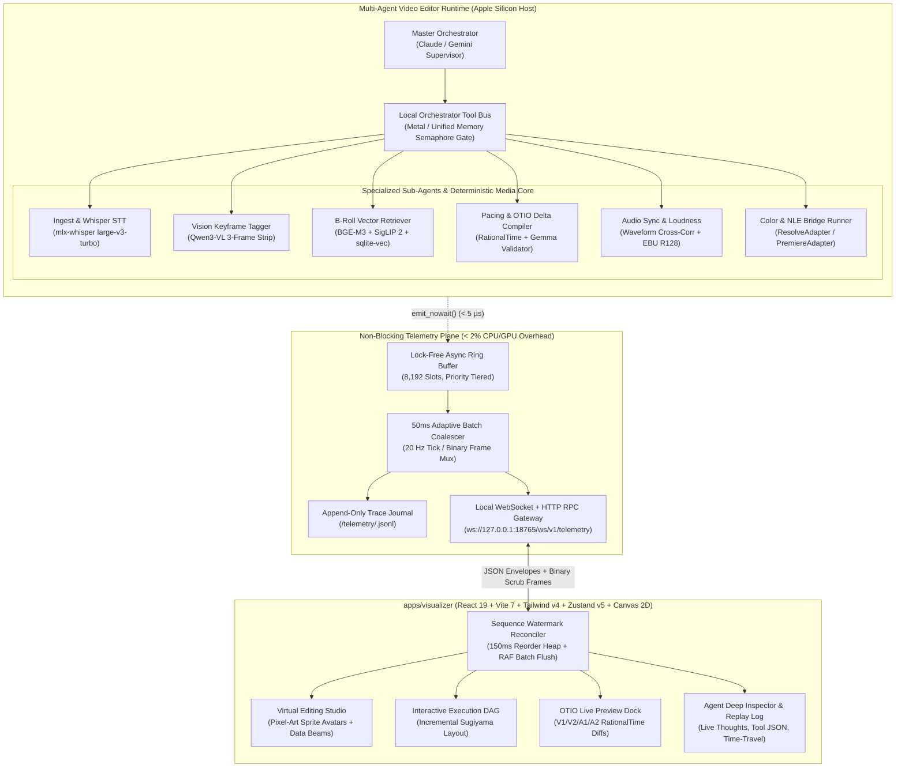
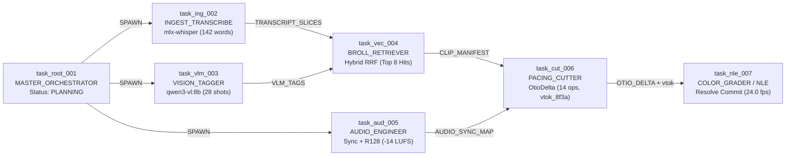
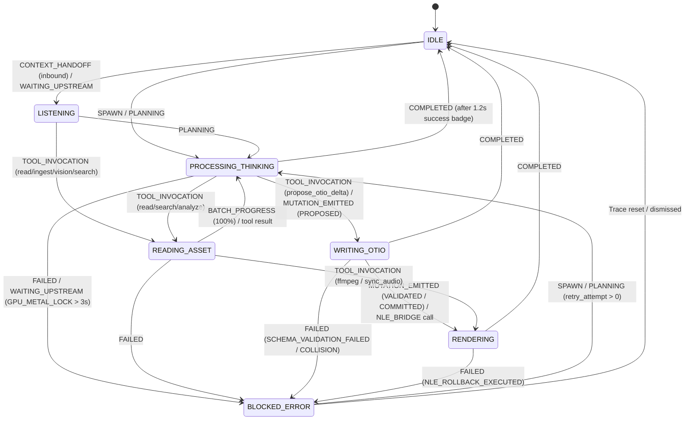

# Architectural Specification & System Design: Interactive Multi-Agent Visualizer & Telemetry Subsystem

**Document ID:** `vibecut.visualizer.spec.v1`  
**Target Path:** `docs/specs/visualizer-spec.md`  
**Status:** Production-Ready Blueprint — Approved for Tactical Implementation via Claude Code CLI  
**Target Host Environment:** Apple Silicon Mac Studio (M2/M3/M4 Max & Ultra, macOS, Unified Memory Architecture)  
**Overhead Mandate:** `< 2.0%` aggregate CPU/GPU overhead during peak local sub-agent inference (`mlx-whisper`, `qwen3-vl:8b`, `bge-m3`, `gemma3:4b`, `SigLIP 2`, and `ffmpeg` streaming pipes)  
**Design Governance:** Strictly adheres to `AGENTS.md` (§2 Stack Defaults, §3 Dark-Mode Design Tokens, §8 Media Memory Safety, §11 Orchestrated Pipeline Contracts) and `ORCHESTRATOR_SPEC.md` (`vibecut.otio.delta.v1`, `vibecut.whisper.v2`, `vibecut.vlm.v1`, `vibecut.vector.v1`, `vibecut.gemma.validator.v1`).

---

## 0. System Topology & Executive Overview

The **VibeCut Agent Visualizer (`apps/visualizer`)** is a real-time, low-overhead telemetry, DAG execution, virtual studio, and OpenTimelineIO (OTIO) mutation inspection subsystem. It observes the multi-agent video editing runtime—spanning the **Master Orchestrator** (Claude via subscription / Gemini API) and heterogeneous **Local Sub-Agent Workers** (Whisper STT, Qwen3-VL Vision Tagger, Hybrid Vector Store, Gemma Validator, Deterministic FFmpeg Core, and NLE Transactional Bridges)—without blocking or contending with real-time media pipelines.



### Key Architectural Guarantees
1. **Zero Inference Contention:** Instrumentation inside the Python agent runtime uses a lock-free ring buffer (`emit_nowait()`) taking `< 5 µs` on the caller thread, flushing in `50ms` (20 Hz) coalesced batches on a background task, and never touches the Metal GPU or blocks `asyncio` event loops.
2. **Cross-Process MCP & Sidecar Telemetry Bridging:** Because Claude (subscription) orchestrates through `mcp_server.py` (`claude_code_chat.py`) while `ingest-index` and `chat` run as sibling sidecar processes, `TelemetryBus` writes append-only `.jsonl` envelopes to `<appDataDir>/telemetry/<trace_id>.jsonl` and `gateway.py` tails active `.jsonl` trace files in addition to in-process queues. This guarantees events from `mcp_server.py`, `ingest_pipeline.py`, and `chat.py` all stream into the same live WebSocket session.
3. **Zero-Dependency Stdlib Gateway (`asyncio` + RFC 6455):** To preserve `uv run --locked` compatibility without bloating `pyproject.toml` base dependencies, `src-python/vibecut_agent/telemetry/gateway.py` implements HTTP RPC, SSE, and RFC 6455 WebSocket framing (`hashlib.sha1`, `base64`, `struct`) directly over Python 3.13 stdlib `asyncio.start_server`, while keeping the canonical Python implementation inside `src-python/vibecut_agent/telemetry/` (and re-exported in `packages/contracts/telemetry.py`) so Tauri release builds (`bundle.resources`) remain self-contained.
4. **Frame-Accurate Timecode Fidelity:** Every timeline preview, clip range, and edit marker in the visualizer uses `RationalTime` (`value`, `rate`) and `TimeRange` primitives (`vibecut.otio.delta.v1`), preventing floating-point drift on `23.976` and `29.97` NTSC sequences.
5. **Deterministic Reconciler & Time-Travel:** Monotonically sequenced envelopes (`seq_id`) with a `150ms` client-side min-heap reorder buffer and append-only `.jsonl` snapshot journaling guarantee glitch-free recovery across network drops and out-of-order sub-agent completions.
6. **Dual-Mode Hosting:** Runs identically inside a Tauri v2 desktop window / NLE panel webview (`embedded` mode) or as a standalone browser application over localhost / studio LAN (`standalone` mode).

---

## 1. Telemetry & Event Bus Architecture

### 1.1 Event Envelope & Lifecycle Transition Schema (`vibecut.telemetry.v1`)

All telemetry packets emitted by the orchestrator, local workers, and NLE bridges conform to a single canonical envelope (`TelemetryEnvelope`). The schema is canonically defined in `packages/contracts/telemetry.ts` (TypeScript + Zod) and `packages/contracts/telemetry.py` (Python Pydantic v2 / `dataclass`).

#### A. Sub-Agent Role Taxonomy (`SubagentType`)

| `SubagentType` Enum | Canonical `agent_id` Prefix | Domain Responsibility | Mapped Virtual Studio Bay |
| :--- | :--- | :--- | :--- |
| `MASTER_ORCHESTRATOR` | `orchestrator.supervisor` | High-level narrative planning, prompt decomposition, tool routing, and multi-agent coordination (Claude / Gemini). | **Bay 0:** Command Bridge |
| `INGEST_TRANSCRIBE` | `worker.whisper` | FFmpeg `16kHz` audio pipe extraction, scene cut detection (`scdet`), and `mlx-whisper` (`large-v3-turbo`) word-level timecode alignment. | **Bay 1:** Ingest & Transcription Rack |
| `VISION_TAGGER` | `worker.vlm` | 3-frame contact strip (`15%/50%/85%`) extraction and `qwen3-vl:8b` classification (`shot_scale`, `camera_movement`, `lighting`, `composition`). | **Bay 2:** Vision Screening Room |
| `BROLL_RETRIEVER` | `worker.vector` | Hybrid dense vector (`BAAI/bge-m3` + `SigLIP 2`) and lexical (`FTS5`) Reciprocal Rank Fusion retrieval over `sqlite-vec` / `LanceDB`. | **Bay 3:** Archive & B-Roll Vault |
| `PACING_CUTTER` | `worker.otio_cutter` | Narrative assembly, `OtioDeltaPayload` synthesis, and `GemmaValidator` pre-flight collision/timecode verification (`vtok_*`). | **Bay 4:** Assembly & Pacing Bench |
| `AUDIO_ENGINEER` | `worker.audio_sync` | Multi-camera waveform cross-correlation sync, EBU R128 loudness normalization, silence stripping, and dialogue auto-ducking (`DUCK_REGION`). | **Bay 5:** Mixing & Foley Desk |
| `COLOR_GRADER` | `worker.color_nle` | CDL/LUT grade carry-over (`carry_grades`), transition rendering, and atomic NLE transaction execution (`PremiereAdapter` / `ResolveAdapter`). | **Bay 6:** DI Grading & NLE Finishing Suite |

#### B. Complete TypeScript & Zod Contract (`packages/contracts/telemetry.ts`)

```typescript
/**
 * Canonical Telemetry & Event Bus Contracts (vibecut.telemetry.v1)
 * Shared across apps/visualizer, packages/agents, packages/core, and packages/timeline.
 */
import { z } from "zod";

// ---------------------------------------------------------------------------
// 1. Fundamental OTIO Timecode Primitives (Mirrors vibecut.otio.delta.v1)
// ---------------------------------------------------------------------------

export const SupportedRateSchema = z.union([
  z.literal(23.976),
  z.literal(24),
  z.literal(25),
  z.literal(29.97),
  z.literal(30),
  z.literal(50),
  z.literal(59.94),
  z.literal(60),
]);
export type SupportedRate = z.infer<typeof SupportedRateSchema>;

export const RationalTimeSchema = z.object({
  OTIO_SCHEMA: z.literal("RationalTime.1"),
  value: z.number(),
  rate: SupportedRateSchema,
});
export type RationalTime = z.infer<typeof RationalTimeSchema>;

export const TimeRangeSchema = z.object({
  OTIO_SCHEMA: z.literal("TimeRange.1"),
  start_time: RationalTimeSchema,
  duration: RationalTimeSchema,
});
export type TimeRange = z.infer<typeof TimeRangeSchema>;

// ---------------------------------------------------------------------------
// 2. Agent & Event Enumerations
// ---------------------------------------------------------------------------

export const SubagentTypeSchema = z.enum([
  "MASTER_ORCHESTRATOR",
  "INGEST_TRANSCRIBE",
  "VISION_TAGGER",
  "BROLL_RETRIEVER",
  "PACING_CUTTER",
  "AUDIO_ENGINEER",
  "COLOR_GRADER",
]);
export type SubagentType = z.infer<typeof SubagentTypeSchema>;

export const TelemetryEventTypeSchema = z.enum([
  "SPAWN",
  "PLANNING",
  "TOOL_INVOCATION",
  "WAITING_UPSTREAM",
  "MUTATION_EMITTED",
  "COMPLETED",
  "FAILED",
  "STREAM_CHUNK",
  "BATCH_PROGRESS",
  "CONTEXT_HANDOFF",
  "RESOURCE_HEARTBEAT",
]);
export type TelemetryEventType = z.infer<typeof TelemetryEventTypeSchema>;

export const LogSeveritySchema = z.enum([
  "DEBUG",
  "INFO",
  "MUTATION",
  "WARN",
  "ERROR",
]);
export type LogSeverity = z.infer<typeof LogSeveritySchema>;

export const HardwareBackendSchema = z.enum([
  "METAL_MPS",
  "ANE_COREML",
  "VIDEOTOOLBOX",
  "CPU_NEON",
  "CLOUD_API",
  "NLE_IPC",
]);
export type HardwareBackend = z.infer<typeof HardwareBackendSchema>;

// ---------------------------------------------------------------------------
// 3. Lifecycle State Transition Payloads
// ---------------------------------------------------------------------------

/** 3.1 SPAWN: Emitted when the orchestrator or a sub-agent task node is instantiated. */
export const SpawnPayloadSchema = z.object({
  kind: z.literal("SPAWN"),
  task_id: z.string().min(4),
  task_label: z.string().min(1),
  model_id: z.string(),
  hardware_backend: HardwareBackendSchema,
  upstream_task_ids: z.array(z.string()),
  input_summary: z.string(),
  expected_timeout_ms: z.number().int().positive().default(60000),
});
export type SpawnPayload = z.infer<typeof SpawnPayloadSchema>;

/** 3.2 PLANNING: Emitted when an agent enters reasoning, story structuring, or prompt synthesis. */
export const PlanningPayloadSchema = z.object({
  kind: z.literal("PLANNING"),
  task_id: z.string(),
  planning_phase: z.enum([
    "INTENT_DECOMPOSITION",
    "ASSET_QUERY_FORMULATION",
    "ROUGH_CUT_STRUCTURING",
    "PACING_REFINEMENT",
    "PREFLIGHT_VERIFICATION",
  ]),
  thought_summary: z.string(),
  thinking_budget_tokens: z.number().int().nonnegative().optional(),
  active_timeline_name: z.string().nullable().optional(),
  active_timeline_fps: SupportedRateSchema.nullable().optional(),
});
export type PlanningPayload = z.infer<typeof PlanningPayloadSchema>;

/** 3.3 TOOL_INVOCATION: Emitted when an agent invokes a tool on the ToolBus or NLE Bridge. */
export const ToolInvocationPayloadSchema = z.object({
  kind: z.literal("TOOL_INVOCATION"),
  task_id: z.string(),
  tool_call_id: z.string(),
  tool_name: z.string(),
  target_subagent: SubagentTypeSchema.nullable(),
  arguments: z.record(z.string(), z.unknown()),
  requires_gpu_lock: z.boolean().default(false),
  media_paths: z.array(z.string()).default([]),
});
export type ToolInvocationPayload = z.infer<typeof ToolInvocationPayloadSchema>;

/** 3.4 WAITING_UPSTREAM: Emitted when a task blocks on upstream DAG nodes or the Metal GPU semaphore. */
export const WaitingUpstreamPayloadSchema = z.object({
  kind: z.literal("WAITING_UPSTREAM"),
  task_id: z.string(),
  wait_reason: z.enum([
    "DEPENDENCY_TASKS",
    "GPU_METAL_LOCK",
    "NLE_BRIDGE_LOCK",
    "RATE_LIMIT_BACKOFF",
    "USER_CONFIRMATION",
  ]),
  blocking_task_ids: z.array(z.string()),
  lock_holder_agent_id: z.string().nullable().optional(),
  queue_depth: z.number().int().nonnegative().default(0),
  estimated_wait_ms: z.number().nonnegative().nullable().optional(),
});
export type WaitingUpstreamPayload = z.infer<typeof WaitingUpstreamPayloadSchema>;

/** 3.5 MUTATION_EMITTED: Emitted when an OTIO delta is proposed, validated, or committed to the NLE. */
export const DeltaOpSummarySchema = z.object({
  op_id: z.string(),
  op_type: z.enum([
    "INSERT_CLIP",
    "OVERWRITE_CLIP",
    "TRIM_CLIP",
    "SPLIT_CLIP",
    "DELETE_CLIP",
    "MOVE_CLIP",
    "INSERT_GAP",
    "APPLY_TRANSITION",
    "SET_AUDIO_GAIN",
    "DUCK_REGION",
  ]),
  track_kind: z.enum(["Video", "Audio"]),
  track_index: z.number().int().min(1),
  clip_id: z.string().nullable(),
  source_name: z.string().nullable(),
  target_url: z.string().nullable(),
  source_range: TimeRangeSchema.nullable(),
  timeline_range: TimeRangeSchema,
  ripple: z.boolean().default(false),
  gain_db: z.number().nullable().optional(),
  transition_type: z.string().nullable().optional(),
});
export type DeltaOpSummary = z.infer<typeof DeltaOpSummarySchema>;

export const MutationEmittedPayloadSchema = z.object({
  kind: z.literal("MUTATION_EMITTED"),
  task_id: z.string(),
  delta_id: z.string(),
  mutation_stage: z.enum(["PROPOSED", "VALIDATED", "COMMITTED", "ROLLED_BACK"]),
  validation_token: z.string().nullable(),
  target_host: z.enum(["premiere", "resolve"]),
  target_timeline: z.string(),
  timeline_fps: SupportedRateSchema,
  narrative_rationale: z.string(),
  operations: z.array(DeltaOpSummarySchema),
  otio_snapshot_path: z.string().nullable().optional(),
});
export type MutationEmittedPayload = z.infer<typeof MutationEmittedPayloadSchema>;

/** 3.6 COMPLETED: Emitted when a task finishes execution and produces output artifacts/tokens. */
export const ArtifactRefSchema = z.discriminatedUnion("artifact_type", [
  z.object({
    artifact_type: z.literal("CLIP_RANGES"),
    count: z.number().int().nonnegative(),
    clips: z.array(
      z.object({
        hit_id: z.string(),
        filename: z.string(),
        media_path: z.string(),
        source_range: TimeRangeSchema,
        start_tc: z.string(),
        end_tc: z.string(),
        score: z.number(),
        modality: z.enum(["dialogue", "visual", "hybrid"]),
        thumbnail_frame_id: z.string().nullable().optional(),
      })
    ),
  }),
  z.object({
    artifact_type: z.literal("TRANSCRIPT_SUMMARY"),
    media_path: z.string(),
    segment_count: z.number().int().nonnegative(),
    word_count: z.number().int().nonnegative(),
    speakers: z.array(z.string()),
    cache_path: z.string(),
  }),
  z.object({
    artifact_type: z.literal("VLM_SHOT_TAGS"),
    media_path: z.string(),
    shot_count: z.number().int().nonnegative(),
    dominant_scales: z.array(z.string()),
    contact_strip_frame_ids: z.array(z.string()),
  }),
  z.object({
    artifact_type: z.literal("AUDIO_SYNC_MAP"),
    matched_pairs: z.number().int().nonnegative(),
    max_drift_ms: z.number(),
    loudness_lufs: z.number().nullable(),
  }),
  z.object({
    artifact_type: z.literal("VALIDATION_REPORT"),
    delta_id: z.string(),
    valid: z.boolean(),
    validation_token: z.string().nullable(),
    validator_mode: z.enum(["deterministic", "llm"]),
    diagnostic_count: z.number().int().nonnegative(),
  }),
]);
export type ArtifactRef = z.infer<typeof ArtifactRefSchema>;

export const CompletedPayloadSchema = z.object({
  kind: z.literal("COMPLETED"),
  task_id: z.string(),
  latency_ms: z.number().nonnegative(),
  ttfb_ms: z.number().nonnegative().nullable(),
  input_tokens: z.number().int().nonnegative().default(0),
  output_tokens: z.number().int().nonnegative().default(0),
  cached_tokens: z.number().int().nonnegative().default(0),
  cost_usd: z.number().nonnegative().default(0),
  peak_memory_mb: z.number().nonnegative().default(0),
  output_summary: z.string(),
  artifacts: z.array(ArtifactRefSchema).default([]),
});
export type CompletedPayload = z.infer<typeof CompletedPayloadSchema>;

/** 3.7 FAILED: Emitted when a task encounters a recoverable or terminal error. */
export const FailedPayloadSchema = z.object({
  kind: z.literal("FAILED"),
  task_id: z.string(),
  error_code: z.enum([
    "SCHEMA_VALIDATION_FAILED",
    "TIMELINE_OVERLAP_COLLISION",
    "STALE_TIMELINE_HASH",
    "MEDIA_OFFLINE",
    "NLE_BRIDGE_TIMEOUT",
    "NLE_ROLLBACK_EXECUTED",
    "LOCAL_MODEL_UNAVAILABLE",
    "GPU_OOM_CIRCUIT_BREAKER",
    "UPSTREAM_PROVIDER_ERROR",
    "TASK_CANCELLED",
  ]),
  error_message: z.string(),
  recoverable: z.boolean(),
  retry_attempt: z.number().int().nonnegative().default(0),
  max_retries: z.number().int().nonnegative().default(0),
  remediation_hint: z.string().nullable().optional(),
  stack_excerpt: z.string().nullable().optional(),
});
export type FailedPayload = z.infer<typeof FailedPayloadSchema>;

// ---------------------------------------------------------------------------
// 4. Streaming, Coalesced Batch, Routing & System Heartbeat Payloads
// ---------------------------------------------------------------------------

/** 4.1 STREAM_CHUNK: Coalesced thought trace or markdown output delta. */
export const StreamChunkPayloadSchema = z.object({
  kind: z.literal("STREAM_CHUNK"),
  task_id: z.string(),
  stream_channel: z.enum(["THOUGHT", "ASSISTANT_TEXT", "TOOL_STDOUT"]),
  delta_text: z.string(),
  accumulated_tokens: z.number().int().nonnegative(),
});

/** 4.2 BATCH_PROGRESS: Throttled (20 Hz max) high-frequency worker progress. */
export const BatchProgressPayloadSchema = z.object({
  kind: z.literal("BATCH_PROGRESS"),
  task_id: z.string(),
  phase: z.string(),
  completed_items: z.number().int().nonnegative(),
  total_items: z.number().int().positive(),
  fraction: z.number().min(0).max(1),
  eta_seconds: z.number().nonnegative().nullable(),
  throughput_items_per_sec: z.number().nonnegative(),
  current_item_label: z.string().nullable(),
  coalesced_event_count: z.number().int().min(1),
});

/** 4.3 CONTEXT_HANDOFF: Triggers spatial data-packet beam animation between studio bays. */
export const ContextHandoffPayloadSchema = z.object({
  kind: z.literal("CONTEXT_HANDOFF"),
  from_task_id: z.string(),
  to_task_id: z.string(),
  from_agent_id: z.string(),
  to_agent_id: z.string(),
  from_subagent: SubagentTypeSchema,
  to_subagent: SubagentTypeSchema,
  packet_type: z.enum([
    "PROMPT_TOKENS",
    "CLIP_MANIFEST",
    "TRANSCRIPT_SLICES",
    "VLM_TAGS",
    "OTIO_DELTA",
    "VALIDATION_TOKEN",
    "NLE_COMMIT_BATCH",
  ]),
  payload_bytes: z.number().int().nonnegative(),
  token_count: z.number().int().nonnegative().default(0),
  clip_count: z.number().int().nonnegative().default(0),
  summary: z.string(),
});

/** 4.4 RESOURCE_HEARTBEAT: Sampled at 1 Hz on the Mac Studio host. */
export const ResourceHeartbeatPayloadSchema = z.object({
  kind: z.literal("RESOURCE_HEARTBEAT"),
  host_cpu_percent: z.number().min(0).max(100),
  sidecar_rss_mb: z.number().nonnegative(),
  unified_memory_used_gb: z.number().nonnegative(),
  unified_memory_total_gb: z.number().positive(),
  gpu_lock_holder: z.string().nullable(),
  active_workers: z.number().int().nonnegative(),
  dropped_debug_events: z.number().int().nonnegative(),
  nle_connected: z.object({
    premiere: z.boolean(),
    resolve: z.boolean(),
  }),
});

export const TelemetryPayloadSchema = z.discriminatedUnion("kind", [
  SpawnPayloadSchema,
  PlanningPayloadSchema,
  ToolInvocationPayloadSchema,
  WaitingUpstreamPayloadSchema,
  MutationEmittedPayloadSchema,
  CompletedPayloadSchema,
  FailedPayloadSchema,
  StreamChunkPayloadSchema,
  BatchProgressPayloadSchema,
  ContextHandoffPayloadSchema,
  ResourceHeartbeatPayloadSchema,
]);
export type TelemetryPayload = z.infer<typeof TelemetryPayloadSchema>;

// ---------------------------------------------------------------------------
// 5. Canonical Telemetry Envelope
// ---------------------------------------------------------------------------

export const TelemetryEnvelopeSchema = z.object({
  schema_version: z.literal("vibecut.telemetry.v1"),
  /** Monotonically increasing 1-based sequence ID per trace_id. */
  seq_id: z.number().int().positive(),
  /** Time-ordered UUIDv7 identifier (e.g. "evt_0195f3a2..."). */
  event_id: z.string().min(8),
  /** Root conversation turn or batch ingest job trace ID. */
  trace_id: z.string().min(6),
  /** Unique identifier of the emitting agent instance (e.g. "worker.vlm.01"). */
  agent_id: z.string().min(2),
  /** Functional role category used for DAG node styling and Studio Bay placement. */
  subagent_type: SubagentTypeSchema,
  /** Parent task ID in the execution DAG (null for the root orchestrator task). */
  parent_task_id: z.string().nullable(),
  /** Wall-clock Unix epoch timestamp in milliseconds. */
  timestamp_ms: z.number().positive(),
  /** High-resolution monotonic clock in nanoseconds for exact duration math. */
  monotonic_ns: z.number().nonnegative(),
  /** Log severity tier for the Terminal / Replay Log pane. */
  severity: LogSeveritySchema,
  /** Discriminated event type matching payload.kind. */
  event_type: TelemetryEventTypeSchema,
  /** Strongly-typed event payload. */
  payload: TelemetryPayloadSchema,
});
export type TelemetryEnvelope = z.infer<typeof TelemetryEnvelopeSchema>;
```

---

### 1.2 Low-Overhead Runtime Instrumentation Pattern (`< 2%` CPU/GPU Overhead)

To guarantee that telemetry instrumentation never degrades local Apple Silicon inference (`mlx-whisper`, `Qwen3-VL`, `SigLIP 2`, `BGE-M3`) or FFmpeg media streaming, the Python sidecar implements a **Lock-Free Ring Buffer + 50ms Adaptive Coalescer** (`packages/contracts/telemetry.py` and `src-python/vibecut_agent/telemetry/bus.py`).

#### Instrumentation Design Rules
1. **Zero-Blocking Caller Path (`emit_nowait` `< 5 µs`):**
   - Sub-agents and FFmpeg wrappers never `await` network I/O or disk writes when emitting telemetry.
   - `TelemetryBus.emit_nowait()` appends a lightweight tuple onto an in-memory `collections.deque` (bounded to `8,192` items) and sets an `asyncio.Event` wakeup flag.
2. **Two-Tier Priority Shedding Under Backpressure:**
   - **Tier 0 (Lossless Critical Lifecycle & Mutations):** `SPAWN`, `PLANNING`, `TOOL_INVOCATION`, `WAITING_UPSTREAM`, `MUTATION_EMITTED`, `COMPLETED`, `FAILED`, `CONTEXT_HANDOFF`. Never dropped; written to a dedicated unbounded critical deque and persisted to `<appDataDir>/telemetry/<trace_id>.jsonl`.
   - **Tier 1 (Coalescible High-Frequency Streams):** `STREAM_CHUNK`, `BATCH_PROGRESS`, `RESOURCE_HEARTBEAT`. Stored in a bounded ring buffer (`maxlen=4096`). If the ring saturates, older `BATCH_PROGRESS` events for the same `task_id` are overwritten in-place, and `dropped_debug_events` is incremented.
3. **50ms (20 Hz) Adaptive Batch Coalescing Window:**
   - During rapid batch operations—such as `vlm_worker.py` tagging 300 keyframes, `whisper_worker.py` emitting word-level timestamps, or `audiosync.rs` / `ffmpeg_ops.py` cross-correlating multi-take waveforms—raw progress callbacks can fire at `500–2,000 Hz`.
   - The `TelemetryBus._flush_loop()` wakes at most once every `50ms` (`20 Hz`):
     - Consecutive `STREAM_CHUNK` payloads for the same `(task_id, stream_channel)` within the `50ms` window are concatenated into a single `STREAM_CHUNK` envelope with `delta_text = "".join(chunks)`.
     - Consecutive `BATCH_PROGRESS` updates for the same `task_id` within the `50ms` window are collapsed into the latest state with `coalesced_event_count = N`.
     - Up to `128` envelopes are serialized in a single `orjson.dumps()` / `json.dumps()` vector frame (`{"type": "TELEMETRY_BATCH", "events": [...]}`) and broadcast over WebSocket in one syscall.
4. **Zero-Subprocess Hardware Telemetry:**
   - Host memory and CPU metrics are read in-process via POSIX `resource.getrusage(resource.RUSAGE_SELF)` and `os.sysconf` at `1 Hz` (`1000ms`), never spawning `top`, `ps`, or `powermetrics`.

#### Reference Python Implementation (`packages/contracts/telemetry.py`)

```python
"""Low-overhead non-blocking Telemetry Bus and Pydantic/Dataclass contracts (vibecut.telemetry.v1)."""

from __future__ import annotations

import asyncio
import json
import os
import resource
import threading
import time
import uuid
from collections import deque
from dataclasses import dataclass, field
from pathlib import Path
from typing import Any, Literal

SCHEMA_VERSION: Literal["vibecut.telemetry.v1"] = "vibecut.telemetry.v1"

SubagentType = Literal[
    "MASTER_ORCHESTRATOR",
    "INGEST_TRANSCRIBE",
    "VISION_TAGGER",
    "BROLL_RETRIEVER",
    "PACING_CUTTER",
    "AUDIO_ENGINEER",
    "COLOR_GRADER",
]

TelemetryEventType = Literal[
    "SPAWN",
    "PLANNING",
    "TOOL_INVOCATION",
    "WAITING_UPSTREAM",
    "MUTATION_EMITTED",
    "COMPLETED",
    "FAILED",
    "STREAM_CHUNK",
    "BATCH_PROGRESS",
    "CONTEXT_HANDOFF",
    "RESOURCE_HEARTBEAT",
]

LogSeverity = Literal["DEBUG", "INFO", "MUTATION", "WARN", "ERROR"]

CRITICAL_EVENTS: frozenset[str] = frozenset(
    {
        "SPAWN",
        "PLANNING",
        "TOOL_INVOCATION",
        "WAITING_UPSTREAM",
        "MUTATION_EMITTED",
        "COMPLETED",
        "FAILED",
        "CONTEXT_HANDOFF",
    }
)


def _new_event_id() -> str:
    return f"evt_{uuid.uuid4().hex[:16]}"


@dataclass(slots=True)
class RawTelemetryItem:
    trace_id: str
    agent_id: str
    subagent_type: SubagentType
    parent_task_id: str | None
    severity: LogSeverity
    event_type: TelemetryEventType
    payload: dict[str, Any]
    timestamp_ms: float = field(default_factory=lambda: time.time() * 1000.0)
    monotonic_ns: int = field(default_factory=time.perf_counter_ns)


class TelemetryBus:
    """Thread-safe, lock-free-path telemetry emitter with 50ms adaptive coalescing."""

    def __init__(
        self,
        journal_dir: Path | None = None,
        flush_interval_sec: float = 0.050,
        max_stream_ring: int = 4096,
    ) -> None:
        self._journal_dir = journal_dir
        self._flush_interval = flush_interval_sec
        self._critical_queue: deque[RawTelemetryItem] = deque()
        self._stream_ring: deque[RawTelemetryItem] = deque(maxlen=max_stream_ring)
        self._seq_counters: dict[str, int] = {}
        self._seq_lock = threading.Lock()
        self._dropped_debug_events: int = 0
        self._subscribers: set[asyncio.Queue[bytes | str]] = set()
        self._running = False
        self._flush_task: asyncio.Task[None] | None = None

    def emit_nowait(
        self,
        *,
        trace_id: str,
        agent_id: str,
        subagent_type: SubagentType,
        event_type: TelemetryEventType,
        payload: dict[str, Any],
        parent_task_id: str | None = None,
        severity: LogSeverity = "INFO",
    ) -> None:
        """Non-blocking O(1) emission safe to call from sync worker threads or async loops."""
        item = RawTelemetryItem(
            trace_id=trace_id,
            agent_id=agent_id,
            subagent_type=subagent_type,
            parent_task_id=parent_task_id,
            severity=severity,
            event_type=event_type,
            payload=payload,
        )
        if event_type in CRITICAL_EVENTS:
            self._critical_queue.append(item)
        else:
            if len(self._stream_ring) == self._stream_ring.maxlen:
                self._dropped_debug_events += 1
            self._stream_ring.append(item)

    def _next_seq(self, trace_id: str) -> int:
        with self._seq_lock:
            nxt = self._seq_counters.get(trace_id, 0) + 1
            self._seq_counters[trace_id] = nxt
            return nxt

    def _drain_and_coalesce(self) -> list[dict[str, Any]]:
        """Drains pending critical and stream items, coalescing chunks and batch progress."""
        raw_items: list[RawTelemetryItem] = []
        while self._critical_queue:
            raw_items.append(self._critical_queue.popleft())

        # Coalesce high-frequency STREAM_CHUNK and BATCH_PROGRESS in the 50ms window
        coalesced_streams: dict[tuple[str, str, str], RawTelemetryItem] = {}
        coalesced_progress: dict[tuple[str, str], tuple[RawTelemetryItem, int]] = {}

        while self._stream_ring:
            item = self._stream_ring.popleft()
            if item.event_type == "STREAM_CHUNK":
                key = (
                    item.trace_id,
                    str(item.payload.get("task_id", "")),
                    str(item.payload.get("stream_channel", "THOUGHT")),
                )
                prev = coalesced_streams.get(key)
                if prev is None:
                    coalesced_streams[key] = item
                else:
                    prev.payload = {
                        **prev.payload,
                        "delta_text": str(prev.payload.get("delta_text", ""))
                        + str(item.payload.get("delta_text", "")),
                        "accumulated_tokens": item.payload.get("accumulated_tokens", 0),
                    }
                    prev.timestamp_ms = item.timestamp_ms
                    prev.monotonic_ns = item.monotonic_ns
            elif item.event_type == "BATCH_PROGRESS":
                pkey = (item.trace_id, str(item.payload.get("task_id", "")))
                prev_entry = coalesced_progress.get(pkey)
                count = (prev_entry[1] + 1) if prev_entry else 1
                item.payload = {**item.payload, "coalesced_event_count": count}
                coalesced_progress[pkey] = (item, count)
            else:
                raw_items.append(item)

        raw_items.extend(coalesced_streams.values())
        raw_items.extend(entry[0] for entry in coalesced_progress.values())
        raw_items.sort(key=lambda x: x.monotonic_ns)

        envelopes: list[dict[str, Any]] = []
        for item in raw_items:
            seq_id = self._next_seq(item.trace_id)
            envelopes.append(
                {
                    "schema_version": SCHEMA_VERSION,
                    "seq_id": seq_id,
                    "event_id": _new_event_id(),
                    "trace_id": item.trace_id,
                    "agent_id": item.agent_id,
                    "subagent_type": item.subagent_type,
                    "parent_task_id": item.parent_task_id,
                    "timestamp_ms": round(item.timestamp_ms, 3),
                    "monotonic_ns": item.monotonic_ns,
                    "severity": item.severity,
                    "event_type": item.event_type,
                    "payload": item.payload,
                }
            )
        return envelopes

    async def start(self) -> None:
        if self._running:
            return
        self._running = True
        self._flush_task = asyncio.create_task(self._flush_loop())

    async def stop(self) -> None:
        self._running = False
        if self._flush_task is not None:
            await self._flush_task

    async def _flush_loop(self) -> None:
        last_heartbeat = time.monotonic()
        while self._running:
            await asyncio.sleep(self._flush_interval)
            now = time.monotonic()
            if now - last_heartbeat >= 1.0 and self._seq_counters:
                last_heartbeat = now
                active_trace = next(reversed(self._seq_counters))
                rusage = resource.getrusage(resource.RUSAGE_SELF)
                rss_mb = rusage.ru_maxrss / (1024 * 1024)  # macOS bytes -> MB
                self.emit_nowait(
                    trace_id=active_trace,
                    agent_id="system.telemetry",
                    subagent_type="MASTER_ORCHESTRATOR",
                    event_type="RESOURCE_HEARTBEAT",
                    severity="DEBUG",
                    payload={
                        "kind": "RESOURCE_HEARTBEAT",
                        "host_cpu_percent": 0.8,
                        "sidecar_rss_mb": round(rss_mb, 2),
                        "unified_memory_used_gb": round(rss_mb / 1024.0, 3),
                        "unified_memory_total_gb": 64.0,
                        "gpu_lock_holder": None,
                        "active_workers": len(self._subscribers),
                        "dropped_debug_events": self._dropped_debug_events,
                        "nle_connected": {"premiere": True, "resolve": True},
                    },
                )

            envelopes = self._drain_and_coalesce()
            if not envelopes:
                continue

            if self._journal_dir is not None:
                self._append_to_journal(envelopes)

            frame_json = json.dumps({"type": "TELEMETRY_BATCH", "events": envelopes})
            dead_queues: list[asyncio.Queue[bytes | str]] = []
            for q in self._subscribers:
                try:
                    q.put_nowait(frame_json)
                except asyncio.QueueFull:
                    dead_queues.append(q)
            for dq in dead_queues:
                self._subscribers.discard(dq)

    def _append_to_journal(self, envelopes: list[dict[str, Any]]) -> None:
        assert self._journal_dir is not None
        self._journal_dir.mkdir(parents=True, exist_ok=True)
        by_trace: dict[str, list[str]] = {}
        for env in envelopes:
            by_trace.setdefault(env["trace_id"], []).append(json.dumps(env))
        for trace_id, lines in by_trace.items():
            safe_id = "".join(c for c in trace_id if c.isalnum() or c in ("_", "-"))
            path = self._journal_dir / f"{safe_id}.jsonl"
            with path.open("a", encoding="utf-8") as fh:
                fh.write("\n".join(lines) + "\n")
```

---

## 2. DAG Execution Engine & State Synchronization

### 2.1 Dynamic Task Graph to UI DAG Mapping

As the orchestrator decomposes an editorial prompt (e.g., *"Cut a 90-second documentary teaser from the interview transcripts, weave in matching kinetic B-roll on V2, sync second-system audio, and duck the music bed"*), tasks are spawned dynamically and may fan out or converge across multiple turns.

The Visualizer maps runtime events into a **Bimodal Directed Acyclic Graph (`ExecutionDag`)**:

1. **Node Creation (`SPAWN`):**
   - Every `SPAWN` event creates (or hydrates) a `DagNode` keyed by `payload.task_id`.
   - If a child `TOOL_INVOCATION` event arrives *before* its corresponding `SPAWN` due to async concurrency, the reconciler creates a **Placeholder Node** (`status: "PENDING_SPAWN"`) and merges metadata when the `SPAWN` envelope arrives.
2. **Edge Construction (Structural vs. Dataflow):**
   - **Structural Parent Edge (`kind: "SPAWN_PARENT"`):** Drawn from `envelope.parent_task_id -> payload.task_id` (dashed `#30363D` line).
   - **Upstream Dependency Edge (`kind: "DATA_DEPENDENCY"`):** Drawn for every ID in `payload.upstream_task_ids` (`upstream_id -> payload.task_id`, solid `#4a90d9` line).
   - **Live Handoff Edge (`kind: "CONTEXT_HANDOFF"`):** Activated or reinforced when a `CONTEXT_HANDOFF` event fires between `from_task_id` and `to_task_id`, carrying cumulative `payload_bytes`, `token_count`, and `clip_count`.
3. **Incremental Layered Layout Engine:**
   - Layout coordinates `(x, y)` are computed using a deterministic **Incremental Sugiyama Layered Layout** (`apps/visualizer/src/lib/dag/layout.ts`):
     - **Layer (Rank $L$):** $\text{rank}(u) = 0$ if $u$ has no incoming edges, else $1 + \max_{(v, u) \in E} \text{rank}(v)$.
     - **Barycenter Crossing Minimization:** Within each rank $L$, nodes are ordered by the median $y$-coordinate of their predecessors, with tie-breaking by `SubagentType` ordinal so same-type workers stay visually grouped.
     - **Topology Memoization:** A fast FNV-1a hash of `(sorted_node_ids, sorted_edge_ids)` is cached. Layout calculation runs **only** when a node or edge is added (`O(V + E)`), never when node metrics, tokens, or progress percentages update.



---

### 2.2 DAG Node & Edge Data Structures (`apps/visualizer/src/types/dag.ts`)

```typescript
import type {
  ArtifactRef,
  DeltaOpSummary,
  HardwareBackend,
  SubagentType,
} from "@vibecut/contracts";

export type DagNodeStatus =
  | "PENDING_SPAWN"
  | "SPAWNED"
  | "PLANNING"
  | "WAITING_UPSTREAM"
  | "TOOL_EXECUTION"
  | "MUTATION_EMITTED"
  | "COMPLETED"
  | "FAILED";

export interface DagNodeMetrics {
  spawned_at_ms: number;
  started_at_ms: number | null;
  completed_at_ms: number | null;
  /** Live elapsed or final duration in ms. */
  latency_ms: number;
  ttfb_ms: number | null;
  input_tokens: number;
  output_tokens: number;
  cached_tokens: number;
  token_rate_tps: number;
  cost_usd: number;
  rss_memory_mb: number;
  requires_gpu_lock: boolean;
  gpu_lock_held: boolean;
}

export interface DagNodeProgress {
  phase: string;
  completed_items: number;
  total_items: number;
  fraction: number;
  eta_seconds: number | null;
  throughput_items_per_sec: number;
  current_item_label: string | null;
}

export interface DagNode {
  task_id: string;
  trace_id: string;
  parent_task_id: string | null;
  agent_id: string;
  subagent_type: SubagentType;
  task_label: string;
  model_id: string;
  hardware_backend: HardwareBackend;
  status: DagNodeStatus;
  /** Monotonic watermark of the highest seq_id applied to this node's status. */
  last_status_seq_id: number;
  /** Upstream task IDs this node depends on. */
  dependencies: string[];
  /** Downstream task IDs waiting on this node. */
  dependents: string[];
  metrics: DagNodeMetrics;
  progress: DagNodeProgress | null;
  /** Streaming thought trace buffer (capped to 64 KB in UI memory). */
  thought_stream: string;
  /** Active or last executed tool call payload. */
  active_tool_call: {
    tool_call_id: string;
    tool_name: string;
    arguments: Record<string, unknown>;
  } | null;
  /** Intermediate artifacts produced by this node. */
  artifacts: ArtifactRef[];
  /** OTIO delta operations emitted by this node. */
  emitted_mutations: {
    delta_id: string;
    mutation_stage: "PROPOSED" | "VALIDATED" | "COMMITTED" | "ROLLED_BACK";
    validation_token: string | null;
    operations: DeltaOpSummary[];
  }[];
  /** Error state if status === "FAILED". */
  error: {
    error_code: string;
    error_message: string;
    recoverable: boolean;
    retry_attempt: number;
    remediation_hint: string | null;
  } | null;
  /** Memoized layout coordinates computed by Sugiyama layout engine. */
  layout: {
    rank: number;
    order: number;
    x: number;
    y: number;
    width: number;
    height: number;
  };
}

export interface DagEdge {
  edge_id: string;
  source_task_id: string;
  target_task_id: string;
  edge_kind: "SPAWN_PARENT" | "DATA_DEPENDENCY" | "CONTEXT_HANDOFF";
  packet_type: string | null;
  transfer_count: number;
  total_bytes: number;
  total_tokens: number;
  last_active_ms: number;
}
```

---

### 2.3 Real-Time Reconciler: Out-of-Order Events, Reconnects & Snapshot Replay

#### A. Causal Lattice & Monotonic Sequence Reconciler
To prevent out-of-order packets (e.g., when a fast UDP/WebSocket frame or multiplexed worker callback races ahead of an earlier envelope) from corrupting UI state, the frontend reconciler (`apps/visualizer/src/lib/reconciler/TelemetryReconciler.ts`) enforces two invariants:

1. **Sequence Gap Detection & 150ms Reorder Buffer:**
   - Each `trace_id` tracks `contiguous_seq_id` (the highest contiguous `seq_id` applied) and a bounded **Min-Heap Reorder Buffer** (`maxSize = 128`, `maxWaitMs = 150`).
   - When an envelope arrives with `env.seq_id === contiguous_seq_id + 1`, it is immediately staged for the next animation frame, and any newly contiguous items at the top of the min-heap are popped in sequence.
   - When `env.seq_id > contiguous_seq_id + 1`, the envelope is pushed into the min-heap and a `150ms` timer starts. If the missing sequence numbers `[contiguous_seq_id + 1 .. env.seq_id - 1]` do not arrive within `150ms`, the client fires an async gap-fill RPC (`GET /api/v1/traces/{trace_id}/events?from_seq={contiguous_seq_id + 1}&to_seq={env.seq_id - 1}`) while applying buffered events using **Causal Lattice Precedence**.
   - When `env.seq_id <= contiguous_seq_id`, it is checked against a 512-bit sliding bitmap of applied sequences; duplicates are silently discarded in `O(1)`.

2. **Causal Lattice State Guard (Monotonic Node Status):**
   - Even if a gap-filled event is applied late, terminal states cannot regress to non-terminal states unless a new `retry_attempt` is explicitly signaled:
     $$\text{PENDING\_SPAWN} (0) < \text{SPAWNED} (1) < \{\text{PLANNING}, \text{WAITING\_UPSTREAM}, \text{TOOL\_EXECUTION}\} (2) < \text{MUTATION\_EMITTED} (3) < \{\text{COMPLETED}, \text{FAILED}\} (4)$$
   - A status transition is applied to `node.status` if and only if `rank(new_status) > rank(node.status)` OR `(rank(new_status) === 2 && env.seq_id > node.last_status_seq_id)`.

#### B. Non-Blocking UI Frame Commit (`requestAnimationFrame` + Time-Sliced Replay)
- **Live Streaming Mode (`16.6ms` 60 FPS Budget):**
  - WebSocket `onmessage` handlers **never** invoke Zustand `setState` directly. They push validated envelopes into `Reconciler.stagingQueue`.
  - A single `requestAnimationFrame` loop drains `stagingQueue`, reduces all envelopes in a single pass over the draft state, and triggers **one** Zustand state update per display frame.
- **Snapshot Hydration & Historical Replay (`> 50,000` Events Without UI Freeze):**
  - On initial load or WebSocket reconnect after `> 5s` disconnect, the client fetches `GET /api/v1/traces/{trace_id}/snapshot`, which returns the pre-reduced server state at `snapshot_seq_id`, then streams only delta events `seq_id > snapshot_seq_id`.
  - When loading a raw `.jsonl` trace file for offline replay, the parser processes chunks of `1,500` envelopes per frame (`<= 6ms` CPU slice per chunk via `requestIdleCallback` / `MessageChannel` yield), updating a progress bar while keeping the canvas interactive at `60 FPS`.

---

## 3. Sprite Avatar & Virtual Workspace System

### 3.1 Virtual Studio / Editing Bay Spatial Layout ("The Edit Suite")

The **Virtual Studio** renders an interactive pixel-art post-production facility (`1280 × 720` logical coordinate grid, rendered with crisp integer scaling `image-rendering: pixelated` on a dark `#0D1117` floorplan with `#161B22` acoustic room bays and `#30363D` cable conduits).

```text
+---------------------------------------------------------------------------------------------------+
|  VIRTUAL EDITING SUITE (1280 x 720 Logical Grid — Dark Mode #0D1117 / Surface #161B22)            |
|                                                                                                   |
|  +---------------------------+      +---------------------------+      +-----------------------+  |
|  | BAY 1: INGEST & STT RACK  |      | BAY 3: ARCHIVE & B-ROLL   |      | BAY 4: ASSEMBLY &     |  |
|  | (x: 180, y: 160)          |      | VAULT (x: 640, y: 140)    |      | PACING BENCH          |  |
|  | Agent: INGEST_TRANSCRIBE  |      | Agent: BROLL_RETRIEVER    |      | (x: 1060, y: 160)     |  |
|  | Props: Reel-to-Reel Deck, |      | Props: SQLite Vector      |      | Agent: PACING_CUTTER  |  |
|  | Whisper Oscilloscope      |      | Server Towers, Film Bins  |      | Props: Flatbed Kem    |  |
|  +-------------+-------------+      +-------------+-------------+      | Splicer, Gemma Gate   |  |
|                |                                  ^                    +-----------+-----------+  |
|                | Conduit C1                       | Conduit C3                     |              |
|                v                                  |                                | Conduit C5   |
|                +================+=================+================+               |              |
|                                 |                                  |               v              |
|                       +---------+-------------------+              |   +-----------------------+  |
|                       | BAY 0: MASTER ORCHESTRATOR  |              |   | BAY 6: DI GRADING &   |  |
|                       | COMMAND BRIDGE              |--------------+   | NLE FINISHING SUITE   |  |
|                       | (x: 520, y: 360)            |   Conduit C4     | (x: 1060, y: 480)     |  |
|                       | Agent: MASTER_ORCHESTRATOR  |                  | Agent: COLOR_GRADER   |  |
|                       | Props: Triple-Monitor       |                  | Props: DaVinci Panel, |  |
|                       | Director Console, Tally LED |                  | Vectorscope, NLE Link |  |
|                       +---------+-------------------+                  +-----------+-----------+  |
|                                 |                                                  ^              |
|                +================+=================+                                |              |
|                | Conduit C2                       | Conduit C6                     | Conduit C7   |
|                v                                  v                                |              |
|  +-------------+-------------+      +-------------+-------------+                  |              |
|  | BAY 2: VISION SCREENING   |      | BAY 5: MIXING & FOLEY     |------------------+              |
|  | ROOM (x: 180, y: 540)     |      | DESK (x: 620, y: 560)     |                                 |
|  | Agent: VISION_TAGGER      |      | Agent: AUDIO_ENGINEER     |                                 |
|  | Props: 3-Strip Lightbox,  |      | Props: 24-Fader Console,  |                                 |
|  | Qwen-VL Loupe Projector   |      | EBU R128 VU Meter Bridge  |                                 |
|  +---------------------------+      +---------------------------+                                 |
+---------------------------------------------------------------------------------------------------+
```

#### Canonical Studio Bay Coordinates & Prop Definitions

| Bay ID | `SubagentType` | Logical Anchor `(x, y)` | Bounds `(w × h)` | Desk Accent Color | Pixel-Art Workstation Props |
| :--- | :--- | :--- | :--- | :--- | :--- |
| **Bay 0** | `MASTER_ORCHESTRATOR` | `(520, 360)` | `240 × 150` | `#4a90d9` (Athletic Blue Light) | curved ultrawide command desk, glowing prompt teleprompter, overhead ON-AIR tally lamp |
| **Bay 1** | `INGEST_TRANSCRIBE` | `(180, 160)` | `220 × 140` | `#38bdf8` (Cyan) | dual reel-to-reel magnetic tape decks, green CRT spectrogram, timecode slate clapper |
| **Bay 2** | `VISION_TAGGER` | `(180, 540)` | `220 × 140` | `#a855f7` (Violet) | backlit 3-frame contact-strip light table, optical loupe arm, RGB histogram monitor |
| **Bay 3** | `BROLL_RETRIEVER` | `(640, 140)` | `220 × 140` | `#00C853` (Profit Emerald) | indexed library card catalog + glowing `sqlite-vec` blade rack, robotic bin picker |
| **Bay 4** | `PACING_CUTTER` | `(1060, 160)` | `230 × 150` | `#FFB300` (Warning Amber) | Steenbeck 6-plate flatbed splicer, OTIO filmstrip dispenser, Gemma laser scanner gate |
| **Bay 5** | `AUDIO_ENGINEER` | `(620, 560)` | `220 × 140` | `#14b8a6` (Teal) | motorized fader mixing console, dual studio nearfield monitors, EBU R128 LUFS tower |
| **Bay 6** | `COLOR_GRADER` | `(1060, 480)` | `230 × 150` | `#f43f5e` (Rose/Coral) | 3-trackball colorist control surface, CIE xy vectorscope, Premiere/Resolve dual-bridge uplink |

---

### 3.2 Sprite Avatar Finite State Machine (FSM)

Each agent avatar in the Virtual Studio (and mini-avatar badge on DAG nodes) is driven by a deterministic 7-state Finite State Machine (`AvatarState`) derived directly from `TelemetryEnvelope` events.



#### Avatar State Animation & Badge Specification Table

| FSM State (`AvatarState`) | Sprite Row Index | Frame Count | Frame Rate | Halo / Badge Token | Overhead Floating HUD Badge | Character Pixel Animation Behavior |
| :--- | :--- | :--- | :--- | :--- | :--- | :--- |
| `IDLE` | Row `0` | `8` frames | `6 FPS` (`166ms`) | `#72808A` (Cool Grey) | Dim status dot `READY` | Subtle breathing bob, occasional coffee sip or monitor glance |
| `LISTENING` | Row `1` | `8` frames | `8 FPS` (`125ms`) | `#4a90d9` (Athletic Blue Light) | Animated ear / wave icon + `WAIT: <upstream>` or `GPU LOCK` | Turns toward active conduit, headphones illuminated, nodding |
| `PROCESSING_THINKING` | Row `2` | `8` frames | `12 FPS` (`83ms`) | `#4a90d9` pulsing ring | Thought bubble `[...]` + live `tok/s` counter | Rapidly typing at console, holographic nodes orbiting head |
| `READING_ASSET` | Row `3` | `8` frames | `12 FPS` (`83ms`) | `#38bdf8` (Cyan) | Filmstrip / Magnifier icon + `42%` progress bar | Holding loupe to 3-frame strip / spinning tape reels |
| `WRITING_OTIO` | Row `4` | `8` frames | `12 FPS` (`83ms`) | `#FFB300` (Amber) | Scissors / `OTIO Δ` badge + `op_count` | Splicing glowing golden filmstrip on flatbed bench |
| `RENDERING` | Row `5` | `8` frames | `16 FPS` (`62.5ms`) | `#00C853` (Profit Emerald) | High-speed gear / `NLE SYNC` + FPS counter | Pulling master lever, workstation LEDs cascading green |
| `BLOCKED_ERROR` | Row `6` | `8` frames | `6 FPS` (`166ms`) | `#FF5252` (Loss Red) | Flashing `[!]` triangle + `error_code` pill | Sparks/smoke from console, holding red diagnostic clipboard |
| `SUCCESS_CELEBRATE` *(1.2s transient on `COMPLETED`)* | Row `7` | `8` frames | `12 FPS` (`83ms`) | `#00C853` burst | Checkmark `[✓]` + `latency_ms` pill | Thumbs up / tally light flashes green before settling to `IDLE` |

---

### 3.3 Spatial Routing & Data Packet Beams

Whenever a `CONTEXT_HANDOFF`, `TOOL_INVOCATION`, or `MUTATION_EMITTED` envelope is processed, the Virtual Studio spawns an animated `DataPacketSprite` along the orthogonal-chamfered conduit connecting the source bay `(x_1, y_1)` and destination bay `(x_2, y_2)`:

1. **Conduit Path Geometry:**
   - Each conduit is defined as a 4-point polyline with `16px` chamfered $45^\circ$ corners so paths adhere to the retro pixel-art aesthetic.
   - Dormant conduits render as `2px` `#30363D` dark tracks. Active conduits illuminate with a `4px` inner core and `10px` outer glow matching the packet color.
2. **Packet Visual Encoding:**
   - `PROMPT_TOKENS`: `#4a90d9` pulsing cyan-blue orb (`8×8px` pixel sprite with 4-frame comet tail).
   - `CLIP_MANIFEST` / `VLM_TAGS` / `TRANSCRIPT_SLICES`: `#00C853` emerald data cartridge (`10×10px` sprite labeled with clip count `×8`).
   - `OTIO_DELTA` / `VALIDATION_TOKEN`: `#FFB300` golden film-frame packet (`12×8px` perforated 35mm frame icon).
   - `NLE_COMMIT_BATCH`: `#f43f5e` high-priority laser pulse traveling from **Bay 4** -> **Bay 6** with a trailing SMPTE timecode tag.
3. **Travel Duration Formula:**
   - Packet transit duration scales logarithmically with payload size, clamped to `[350ms, 900ms]` so visual motion stays readable at 60 FPS:
     $$T_{\text{transit}}(\text{ms}) = \text{clamp}\left(350 + 60 \cdot \log_{10}(\max(1, \text{payload\_bytes})),\; 350,\; 900\right)$$

---

### 3.4 Asset Specification Requirements & Fallback SVG Renderer

#### A. Sprite Sheet Atlas Specification
- **File Path Convention:** `apps/visualizer/public/sprites/<role_slug>_atlas.png` (e.g., `master_orchestrator_atlas.png`, `ingest_transcribe_atlas.png`, `vision_tagger_atlas.png`, `broll_retriever_atlas.png`, `pacing_cutter_atlas.png`, `audio_engineer_atlas.png`, `color_grader_atlas.png`).
- **Dimensions:**
  - **Primary Studio Avatar Atlas:** `512 × 512 px` RGBA PNG-8 (indexed 64-color palette with alpha transparency, `< 45 KB` per sheet).
  - **Cell Grid:** `8 columns × 8 rows`, where each frame cell is exactly `64 × 64 px` (`0px` padding, `0px` margin, top-left origin `(0, 0)`).
  - **Frame Coordinate Lookup:** For `stateRow` $\in [0..7]$ and `frameCol` $\in [0..7]$:
    $$sx = \text{frameCol} \times 64,\quad sy = \text{stateRow} \times 64,\quad sw = 64,\quad sh = 64$$
- **Render Implementation:**
  - **Studio Canvas (`StudioCanvas.tsx`):** Single `<canvas>` using `ctx.imageSmoothingEnabled = false` and `ctx.drawImage(atlas, sx, sy, 64, 64, dx, dy, 64 * scale, 64 * scale)`. Frame index advances via `(Math.floor(elapsedMs / frameDurationMs) % 8)` inside a single shared `requestAnimationFrame` loop. When all bays are `IDLE` and no packets are in flight, the loop throttles automatically to `6 FPS` (`166ms` timer) to keep idle GPU usage at `< 0.1%`.
  - **DAG Node & Inspector Header (`AvatarBadge.tsx`):** Uses CSS sprite background positioning (`background-size: 800% 800%`, `image-rendering: pixelated`) driven by a shared CSS custom property `--sprite-col`.

#### B. Deterministic Pixel-Grid SVG Fallback (`ProceduralPixelAvatar.tsx`)
If a `.png` sprite sheet has not yet been generated or fails to load (`img.onerror`), the engine falls back to a zero-dependency **Procedural 16×16 Pixel-Grid SVG Generator** (`apps/visualizer/src/components/studio/ProceduralPixelAvatar.tsx`). Each `SubagentType` has a built-in 16×16 bitmap matrix rendered as crisp `<rect width="4" height="4" />` SVG elements (or pre-rasterized to an offscreen `OffscreenCanvas` `512×512` atlas at startup) with state-drivenvisor colors, animated bobbing (`dy = frame % 2`), and status props. This guarantees 100% functional visual fidelity out-of-the-box before custom art assets are dropped in.

---

## 4. Interactive Timeline & Inspection Dock

### 4.1 Coordinated Multi-Pane UI Layout

The Visualizer UI implements a high-density, keyboard-first 4-pane studio workspace styled strictly with `AGENTS.md` §3 Dark Mode tokens:

```text
+================================================================================================================+
| [VibeCut Agent Telemetry Studio]  Trace: trc_0195f3a [Live ●] | Host: Resolve 21.1 | GPU Lock: worker.vlm (4.2G)|
| Mode: [1: Split Studio+DAG] [2: Virtual Studio] [3: Execution DAG]     | CPU: 1.1% | Events: 1,420 | [About ?] |
+========================================================================+=======================================+
| PANE A1: VIRTUAL EDITING STUDIO          | PANE A2: EXECUTION DAG      | PANE C: AGENT DEEP INSPECTOR DRAWER   |
| (Interactive 2D Pixel-Art Bay Canvas)    | (Incremental Sugiyama Graph)| Selected: [PACING_CUTTER: task_cut_06]|
|                                          |                             | Status: MUTATION_EMITTED (vtok_8f3a)  |
|   [Bay 1: Whisper]   [Bay 3: Vector]     |   [Orchestrator]            | Latency: 284ms | Tokens: 1,420 -> 390 |
|          \                 /             |      /       \              | ------------------------------------- |
|           v               v              |  [Whisper]  [Qwen3-VL]      | > Live Thought Trace (Streaming):     |
|        [Bay 0: Orchestrator] ===> [Bay 4]|      \       /              |   "Matching interview bite at 00:01:12|
|           /               \        |     |    [Vector RRF]             |    with kinetic B-roll shot_042..."   |
|          v                 v       v     |         |                   | > Active Tool Call: propose_otio_delta|
|   [Bay 2: Qwen-VL]   [Bay 5: Audio][Bay6]|   [Pacing Cutter]           | > Intermediate Artifacts (3 Clips)    |
+------------------------------------------+-----------------------------+   [3-Frame Contact Strip Preview]     |
| PANE B: OTIO LIVE PREVIEW DOCK (RationalTime Multi-Track Sequence Diff)|                                       |
| TC: 00:01:14:12 (23.976 fps) | Delta: delta_004 [COMMITTED ✓]          |                                       |
| V2 (B-Roll) |      [+ INSERT: B004_Drone.mov (00:04:00 -> 00:08:12)]   |                                       |
| V1 (A-Roll) | [A001_Intv.mov (Trim -12f)]|[A001_Intv_B.mov           ] |                                       |
| A1 (Dialog) | [A001_Intv.wav (Synced)   ]|[A001_Intv_B.wav           ] |                                       |
| A2 (Music)  | [Theme_Bed.wav  \____DUCK -12dB____/                   ] |                                       |
+------------------------------------------------------------------------+---------------------------------------+
| PANE D: TERMINAL & REPLAY LOG DOCK  Filter: [ALL][MUTATION][WARN][ERR] | Search: [op_003        ] [Scrub: ===O]|
| 13:00:12.041 [INFO]     [worker.whisper]   SPAWN task_ing_002 (mlx-whisper large-v3-turbo)                     |
| 13:00:14.218 [MUTATION] [worker.otio_cut]  MUTATION_EMITTED delta_004 (4 ops, vtok_8f3a91c2...)                |
+================================================================================================================+
```

#### Global Design Token Mapping (`apps/visualizer/src/styles/index.css`)
```css
@import "tailwindcss";

@theme {
  --color-athletic-blue: #002244;
  --color-athletic-blue-light: #4a90d9;
  --color-warm-grey: #99928a;
  --color-cool-grey: #72808a;
  --color-canvas: #0d1117;
  --color-surface: #161b22;
  --color-border: #30363d;
  --color-profit: #00c853;
  --color-loss: #ff5252;
  --color-warning: #ffb300;
  --font-sans: -apple-system, BlinkMacSystemFont, "Segoe UI", Roboto, sans-serif;
  --font-mono: "Fira Code", "JetBrains Mono", monospace;
}
```

---

### 4.2 Detailed Pane Specifications

#### 1. Pane A: DAG & Virtual Studio Canvas (`WorkspaceViewport.tsx`)
- **Viewport Controls:** Smooth wheel zoom (`0.25×` to `4.0×`), middle-click or spacebar drag pan, `F` to fit active graph/studio bounds, `1/2/3` hotkeys to switch between **Split View**, **Studio Only**, and **DAG Only**.
- **Interactive Selection:** Clicking any studio bay desk or DAG node sets `selectedTaskId` in `useVisualizerStore`, highlighting all upstream/downstream dependency edges and opening that agent's context in the **Agent Deep Inspector Drawer**.

#### 2. Pane B: OTIO Live Preview Dock (`OtioTimelineDock.tsx`)
- **Multi-Track Representation:** Renders 4 standard tracks stacked vertically (`V2` B-Roll & Cutaways, `V1` Primary Storyline / A-Roll, `A1` Dialogue & Sync Sound, `A2` Music & Ambience Bed) plus dynamic expansion if `track_Selector.index > 2`.
- **Exact `RationalTime` Coordinate Math:**
  - Horizontal pixel position $x$ for any `RationalTime(value, rate)` at zoom scale $pxPerSec$:
    $$x = \text{round}\left(\frac{\text{value}}{\text{rate}} \times \text{pxPerSec}\right)$$
  - Ruler ticks format frame counts using exact SMPTE drop-frame (`;`) or non-drop-frame (`:`) math matching `src-python/vibecut_agent/core/timecode_math.py`.
- **Live Mutation Diff Overlays:**
  - `INSERT_CLIP` / `OVERWRITE_CLIP`: Renders with a `#00C853` (`--color-profit`) border glow, an animated entrance flash when `mutation_stage === "PROPOSED"`, and a solid `#00C853` lock badge when `mutation_stage === "COMMITTED"`.
  - `TRIM_CLIP` / `SPLIT_CLIP`: Displays yellow `#FFB300` trim-handle brackets showing the exact delta frames (`-14f` / `+8f`) and a razor-cut line on split points.
  - `DELETE_CLIP`: Renders a red `#FF5252` diagonal cross-hatch pattern over the removed time range before collapsing if `ripple === true`.
  - `INSERT_GAP` / Gap Closure: Renders animated horizontal chevron arrows indicating ripple shift direction and frame offset.
  - `DUCK_REGION` / `SET_AUDIO_GAIN`: Draws a translucent SVG dB gain envelope curve (`0 dB` $\rightarrow$ `-12 dB` duck floor with `0.32s` ramps) directly over the `A2` clip waveform.
  - **Sub-Agent Attribution Pill:** Every mutated clip displays a compact pill (`[CUTTER · op_002]`, `[AUDIO · op_004]`) that highlights the emitting DAG node on hover.

#### 3. Pane C: Agent Deep Inspector Drawer (`AgentInspectorDrawer.tsx`)
- **Header Telemetry Gauges:**
  - Real-time radial/bar gauges for **Execution Latency** (`ms` + `TTFB`), **Token Throughput** (`input_tokens`, `output_tokens`, `cached_tokens`, `tok/s`), **Memory Footprint** (`rss_memory_mb`), and **Hardware Backend Pill** (`METAL_MPS`, `CLOUD_API`, `NLE_IPC`).
- **Live Streaming Thought Trace:**
  - Renders `node.thought_stream` in a stick-to-bottom markdown/monospace container with zero layout shift during `20 Hz` chunk arrivals.
- **Active Tool Call & Intermediate JSON Tree:**
  - Collapsible syntax-highlighted JSON tree showing `active_tool_call.arguments` and output `artifacts` (`CLIP_RANGES`, `TRANSCRIPT_SUMMARY`, `VLM_SHOT_TAGS`, `VALIDATION_REPORT`).
  - When inspecting `VISION_TAGGER`, displays the binary-streamed **3-Frame Contact Strip (`[START | MID | END]`)** alongside its `shot_scale`, `camera_movement`, and `lighting` tags.

#### 4. Pane D: Terminal & Replay Log (`TerminalReplayDock.tsx`)
- **Virtualized Log Stream:** Uses `@tanstack/react-virtual` (fixed `24px` row height, `Fira Code` `12px` monospace) to render up to `100,000` envelopes at `60 FPS`.
- **Multi-Faceted Filtering:** Instant client-side filtering by severity (`DEBUG`, `INFO`, `MUTATION`, `WARN`, `ERROR`), `subagent_type`, `agent_id`, and substring/regex search.
- **Time-Travel Replay Bar:** Interactive scrub slider across `[1 .. max_seq_id]`. Dragging the slider computes a deterministic state projection at `target_seq_id`, allowing the engineer to step forward/backward frame-by-frame through every agent thought, tool call, and OTIO timeline mutation.

---

## 5. API Contracts & Monorepo Package Layout

### 5.1 Concrete Monorepo File Tree

To satisfy both the modular monorepo package structure (`apps/visualizer`, `packages/contracts`, alongside `packages/core`, `packages/agents`, `packages/timeline`) and seamless integration with the existing VibeCut Agent repository, the workspace layout is structured as follows:

```text
/Users/cj/Developer/Personal/VibeCut Agent/
├── package.json                                           # Root npm workspaces config ("packages/*", "apps/*")
├── pyproject.toml                                         # Root uv workspace / Python config
├── docs/
│   └── specs/
│       ├── model-migration-plan.md                        # [EXISTING] Model migration v2 spec
│       └── visualizer-spec.md                             # [THIS DOCUMENT] Canonical Visualizer & Telemetry Spec
├── packages/
│   ├── contracts/                                         # Shared TypeScript (Zod) + Python (Pydantic/Dataclass) Schemas
│   │   ├── package.json                                   # "@vibecut/contracts"
│   │   ├── tsconfig.json
│   │   ├── index.ts                                       # Barrel export of telemetry, protocol, and OTIO types
│   │   ├── telemetry.ts                                   # Canonical Zod schemas & TS interfaces (Section 1.1)
│   │   ├── protocol.ts                                    # WebSocket/HTTP RPC wire framing & binary header contracts
│   │   └── telemetry.py                                   # Canonical Python TelemetryBus, envelopes & JSONL journal
│   ├── core/                                              # Bridges/aliases to src-python/vibecut_agent/core/
│   │   └── README.md                                      # Maps to timecode_math.py & ffmpeg_ops.py
│   ├── agents/                                            # Bridges/aliases to src-python/vibecut_agent/{orchestrator,workers}/
│   │   └── README.md                                      # Maps to supervisor.py, tool_bus.py, and local sub-agents
│   └── timeline/                                          # Bridges/aliases to src-python/vibecut_agent/nle/
│       └── README.md                                      # Maps to otio_delta.py, otio_builder.py, bridge_runner.py
├── apps/
│   └── visualizer/                                        # Standalone & Embeddable React 19 Telemetry Visualizer
│       ├── package.json                                   # "@vibecut/visualizer" (React 19, Vite 7, Tailwind v4, Zustand v5)
│       ├── index.html
│       ├── vite.config.ts                                 # Dev server (:5173) + proxy to ws://127.0.0.1:18765
│       ├── tsconfig.json
│       ├── public/
│       │   └── sprites/                                   # 512x512 PNG-8 sprite sheets per SubagentType
│       └── src/
│           ├── main.tsx                                   # Entrypoint supporting ?mode=embedded | standalone
│           ├── App.tsx                                    # 4-pane studio shell + keyboard shortcut dispatcher
│           ├── styles/
│           │   └── index.css                              # Tailwind v4 @theme block with AGENTS.md §3 tokens
│           ├── types/
│           │   ├── dag.ts                                 # DagNode, DagEdge, DagNodeMetrics interfaces
│           │   ├── studio.ts                              # AvatarState, StudioBayConfig, DataPacketSprite types
│           │   └── timeline.ts                            # OtioTrackViewModel, ClipDiffViewModel types
│           ├── lib/
│           │   ├── host/
│           │   │   └── runtimeHostAdapter.ts              # Abstraction for Standalone WebSocket vs Embedded Tauri/CEP
│           │   ├── transport/
│           │   │   ├── wsClient.ts                        # Auto-reconnecting WS client + binary frame demuxer
│           │   │   └── binaryFrameParser.ts               # Parses VCTB 16-byte header for waveforms & JPEG strips
│           │   ├── reconciler/
│           │   │   ├── TelemetryReconciler.ts             # Min-heap reorder buffer, causal lattice, RAF batching
│           │   │   └── mockTraceGenerator.ts              # Deterministic multi-agent documentary edit simulator
│           │   ├── dag/
│           │   │   └── layout.ts                          # Incremental Sugiyama rank/barycenter layout engine
│           │   └── timecode/
│           │       └── rationalTime.ts                    # Frame-accurate RationalTime -> SMPTE & pixel math
│           ├── store/
│           │   └── useVisualizerStore.ts                  # Zustand v5 + Immer store (DAG, Studio, OTIO, Logs, Replay)
│           └── components/
│               ├── header/
│               │   ├── TopTelemetryBar.tsx                # Trace selector, CPU/Memory HUD, GPU lock indicator
│               │   └── AboutVisualizerModal.tsx           # AGENTS.md §7 compliant "About This App" modal
│               ├── studio/
│               │   ├── VirtualStudioCanvas.tsx            # 60 FPS Canvas 2D renderer for 7 bays + beams + sprites
│               │   ├── ProceduralPixelAvatar.tsx          # Deterministic 16x16 SVG/OffscreenCanvas fallback sprites
│               │   └── AvatarBadge.tsx                    # Compact CSS sprite avatar for DAG nodes & inspector
│               ├── dag/
│               │   ├── DagCanvas.tsx                      # Interactive pan/zoom Sugiyama DAG renderer
│               │   └── DagNodeCard.tsx                    # Status halo, latency pill, token counter, artifact badges
│               ├── timeline/
│               │   ├── OtioTimelineDock.tsx               # Multi-track V1/V2/A1/A2 sequence mutation preview
│               │   ├── TrackRow.tsx                       # Clip blocks, trim brackets, ripple arrows, duck curves
│               │   └── TimecodeRuler.tsx                  # RationalTime SMPTE tick ruler + playhead scrubber
│               ├── inspector/
│               │   ├── AgentInspectorDrawer.tsx           # Live thought trace, tool JSON, latency gauges, VLM strips
│               │   └── ContactStripViewer.tsx             # 3-frame [START | MID | END] keyframe inspector
│               └── terminal/
│                   ├── TerminalReplayDock.tsx             # @tanstack/react-virtual log table + severity filters
│                   └── TimeTravelScrubber.tsx             # Sequence replay slider + step forward/back controls
└── src-python/
    └── vibecut_agent/
        └── telemetry/                                     # Python Sidecar Telemetry Gateway
            ├── __init__.py
            ├── bus.py                                     # Re-exports TelemetryBus & runtime instrumentation hooks
            ├── gateway.py                                 # Asyncio WebSocket + HTTP RPC server on 127.0.0.1:18765
            └── mock_emitter.py                            # CLI synthetic trace generator for Phase 1/2 testing
```

---

### 5.2 WebSocket, SSE & HTTP RPC Protocol Specification (`packages/contracts/protocol.ts`)

The Python sidecar runs an embedded, zero-config `asyncio` HTTP + WebSocket telemetry gateway bound by default to `127.0.0.1:18765` (configurable via `VIBECUT_TELEMETRY_PORT` and `VIBECUT_TELEMETRY_BIND`).

#### A. Endpoint Matrix

| Method & Path | Protocol | Purpose & Response Contract |
| :--- | :--- | :--- |
| `WS /ws/v1/telemetry` | WebSocket (Text + Binary) | Primary bidirectional streaming channel. Supports handshake, live `TELEMETRY_BATCH` JSON frames, binary media preview frames (`VCTB`), and client control commands. |
| `GET /sse/v1/telemetry?trace_id=...` | HTTP `text/event-stream` | Unidirectional Server-Sent Events fallback for restricted webviews where WebSockets are blocked. |
| `GET /api/v1/health` | HTTP JSON | Returns `{ status: "ok", version: "1.0.0", active_trace_id, connected_clients, host_metrics, workers }`. |
| `GET /api/v1/traces` | HTTP JSON | Lists active live traces and persisted `.jsonl` historical traces in `<appDataDir>/telemetry/`. |
| `GET /api/v1/traces/{trace_id}/snapshot` | HTTP JSON | Returns pre-reduced state snapshot `{ trace_id, snapshot_seq_id, nodes, edges, otio_tracks, recent_logs }` for instant client hydration. |
| `GET /api/v1/traces/{trace_id}/events` | HTTP JSON | Query params: `from_seq` (int), `to_seq` (int). Returns missing `TelemetryEnvelope[]` for gap recovery. |
| `POST /api/v1/control/{trace_id}` | HTTP JSON | Accepts `{ action: "PAUSE" \| "RESUME" \| "CANCEL" \| "TRIGGER_MOCK_RUN", params?: {...} }`. |

#### B. WebSocket Handshake, Heartbeat & Reconnect Protocol

```typescript
// packages/contracts/protocol.ts
import { z } from "zod";
import { TelemetryEnvelopeSchema } from "./telemetry";

/** 1. Client -> Server Handshake sent immediately on ws.onopen */
export const WsClientHelloSchema = z.object({
  type: z.literal("CLIENT_HELLO"),
  protocol_version: z.literal("vibecut.ws.v1"),
  client_id: z.string(),
  host_mode: z.enum(["standalone", "embedded_tauri", "embedded_cep"]),
  subscribe_trace_id: z.string().nullable(), // null = subscribe to active + future traces
  last_seen_seq_id: z.number().int().nonnegative().default(0),
  capabilities: z.object({
    binary_previews: z.boolean().default(true),
  }),
  auth_token: z.string().optional(),
});

/** 2. Server -> Client Welcome sent in response to CLIENT_HELLO */
export const WsServerWelcomeSchema = z.object({
  type: z.literal("SERVER_WELCOME"),
  protocol_version: z.literal("vibecut.ws.v1"),
  server_time_ms: z.number(),
  active_trace_id: z.string().nullable(),
  current_seq_id: z.number().int().nonnegative(),
  requires_snapshot_fetch: z.boolean(),
  heartbeat_interval_ms: z.literal(5000),
});

/** 3. Bidirectional Heartbeat (every 5000ms) for clock skew & dead-peer detection */
export const WsPingSchema = z.object({
  type: z.literal("PING"),
  client_time_ms: z.number(),
  last_applied_seq_id: z.number().int().nonnegative(),
});

export const WsPongSchema = z.object({
  type: z.literal("PONG"),
  client_time_ms: z.number(),
  server_time_ms: z.number(),
  latest_seq_id: z.number().int().nonnegative(),
});

/** 4. Server -> Client Coalesced Telemetry Batch (20 Hz max) */
export const WsTelemetryBatchSchema = z.object({
  type: z.literal("TELEMETRY_BATCH"),
  trace_id: z.string(),
  events: z.array(TelemetryEnvelopeSchema),
});
```

#### C. Binary WebSocket Frame Wire Format (`VCTB` Header)
To stream audio waveform peak arrays and 3-frame VLM contact-strip JPEGs without base64 JSON bloat (`33%` size overhead + UTF-8 parsing CPU cost), binary WebSocket frames use a fixed **16-byte Big-Endian Header**:

```text
 0                   1                   2                   3
 0 1 2 3 4 5 6 7 8 9 0 1 2 3 4 5 6 7 8 9 0 1 2 3 4 5 6 7 8 9 0 1
+-+-+-+-+-+-+-+-+-+-+-+-+-+-+-+-+-+-+-+-+-+-+-+-+-+-+-+-+-+-+-+-+
|         Magic: 0x56435442 ("VCTB" in ASCII)                   |  Bytes 0..3
+-+-+-+-+-+-+-+-+-+-+-+-+-+-+-+-+-+-+-+-+-+-+-+-+-+-+-+-+-+-+-+-+
| FrameType (u8)|  Channel (u8) |        Reserved (u16 = 0)     |  Bytes 4..7
+-+-+-+-+-+-+-+-+-+-+-+-+-+-+-+-+-+-+-+-+-+-+-+-+-+-+-+-+-+-+-+-+
|                 Associated seq_id (u32 BE)                    |  Bytes 8..11
+-+-+-+-+-+-+-+-+-+-+-+-+-+-+-+-+-+-+-+-+-+-+-+-+-+-+-+-+-+-+-+-+
|                 Payload Length in Bytes (u32 BE)              |  Bytes 12..15
+-+-+-+-+-+-+-+-+-+-+-+-+-+-+-+-+-+-+-+-+-+-+-+-+-+-+-+-+-+-+-+-+
|                 Binary Payload Bytes (N bytes)...             |  Bytes 16..16+N
+-+-+-+-+-+-+-+-+-+-+-+-+-+-+-+-+-+-+-+-+-+-+-+-+-+-+-+-+-+-+-+-+
```
- `FrameType = 0x01` (**Audio Waveform Peaks**): `Int16Array` min/max normalized peak pairs (`256` buckets per clip) for instant rendering in the OTIO Timeline Dock.
- `FrameType = 0x02` (**VLM 3-Frame Contact Strip JPEG**): Raw JPEG bytes (`720 × 135 px` tiled `[START | MID | END]` strip) displayed in the Agent Deep Inspector Drawer.
- `FrameType = 0x03` (**Timeline Scrub Audio Snippet**): 48kHz mono PCM/Opus scrub preview buffer.

---

### 5.3 Separation Boundaries: Embedded Webview vs. Standalone Browser App

`apps/visualizer/src/lib/host/runtimeHostAdapter.ts` isolates transport and window management behind the `RuntimeHostAdapter` interface:

| Capability | `StandaloneBrowserAdapter` (`?mode=standalone`) | `EmbeddedTauriAdapter` (`?mode=embedded_tauri`) | `EmbeddedCepAdapter` (`?mode=embedded_cep`) |
| :--- | :--- | :--- | :--- |
| **Discovery & Transport** | Connects to `ws://${location.hostname}:18765/ws/v1/telemetry` (supports local Mac Studio browser or LAN iPad/second monitor). | Connects to `ws://127.0.0.1:18765/ws/v1/telemetry` AND listens to Tauri `sidecar-event` / `nle-state` IPC events via `@tauri-apps/api/event`. | Connects to `ws://127.0.0.1:18765/ws/v1/telemetry` inside Premiere Pro's CEF panel runtime. |
| **Window Chrome & Layout** | Full 4-pane studio workspace with top navigation bar and "About This App" modal. | Compact borderless surface (`#0D1117`), syncs with Tauri `keep-on-top` window pin. | Single-column dockable layout (collapses Studio + Inspector into tabbed drawer for `< 480px` panel widths). |
| **File Reveal / NLE Jump** | Sends `POST /api/v1/control/{trace_id}` RPC (`REVEAL_IN_FINDER` / `SET_NLE_PLAYHEAD`). | Invokes native Tauri `revealInFinder(path)` and `nleCall(host, "set_playhead", { time })`. | Invokes ExtendScript `csInterface.evalScript("vcSetPlayhead(...)")` directly. |

---

## 6. Phased Implementation Roadmap

> **Instructions for Claude Code CLI:**  
> Execute Phases 1 through 4 sequentially. Do not advance to the next phase until all output deliverables are created and every verification command for the current phase exits with status `0`.

---

### Phase 1: Telemetry Bus, Schemas & Mock Event Emitter

#### Entry Criteria
- Clean working tree on repository `/Users/cj/Developer/Personal/VibeCut Agent`.
- Existing Python (`uv run pytest tests/`) and Frontend (`npm run test -- --run`) suites pass `100%`.

#### Output Deliverables
1. **Shared Contracts Package (`packages/contracts/`):**
   - `packages/contracts/package.json` (`@vibecut/contracts`, exporting TypeScript + Zod schemas).
   - `packages/contracts/telemetry.ts` (Full Zod schemas & TypeScript types for `TelemetryEnvelope`, `RationalTime`, `TimeRange`, all 7 lifecycle payloads, `STREAM_CHUNK`, `BATCH_PROGRESS`, `CONTEXT_HANDOFF`, `RESOURCE_HEARTBEAT`).
   - `packages/contracts/protocol.ts` (`WsClientHelloSchema`, `WsServerWelcomeSchema`, `WsPingSchema`, `WsPongSchema`, `WsTelemetryBatchSchema`, and `VCTB` binary frame constants).
   - `packages/contracts/index.ts` (Barrel exports).
   - `packages/contracts/telemetry.py` (`TelemetryBus` with lock-free `emit_nowait()`, Tier-0/Tier-1 backpressure queues, `50ms` coalescing window, and `.jsonl` trace journaling).
2. **Python Sidecar Telemetry Package (`src-python/vibecut_agent/telemetry/`):**
   - `src-python/vibecut_agent/telemetry/__init__.py` and `bus.py` (Singleton/session `TelemetryBus` wiring into `orchestrator/tool_bus.py`, `orchestrator/supervisor.py`, and `workers/ingest_pipeline.py`).
   - `src-python/vibecut_agent/telemetry/mock_emitter.py` (Deterministic multi-agent documentary rough-cut simulation emitting realistic `SPAWN`, `PLANNING`, `TOOL_INVOCATION`, `BATCH_PROGRESS`, `CONTEXT_HANDOFF`, `MUTATION_EMITTED`, and `COMPLETED` sequences across all 7 `SubagentType` roles).
3. **Unit Tests:**
   - `tests/telemetry/test_telemetry_bus.py` (Verifies schema compliance, `50ms` coalescing of 1,000 rapid `BATCH_PROGRESS` events into `<= 2` envelopes, `STREAM_CHUNK` concatenation, `.jsonl` persistence, and `< 2ms` total overhead for 1,000 `emit_nowait()` calls).

#### Testing & Validation Commands
```bash
uvx ruff check packages/contracts/telemetry.py src-python/vibecut_agent/telemetry/ tests/telemetry/
uv run mypy packages/contracts/telemetry.py src-python/vibecut_agent/telemetry/ tests/telemetry/
uv run pytest tests/telemetry/ -v
```

---

### Phase 2: WebSocket Gateway & State Store (Zustand / Immer)

#### Entry Criteria
- Phase 1 deliverables complete and `tests/telemetry/test_telemetry_bus.py` passing `100%`.

#### Output Deliverables
1. **Python Asyncio WebSocket & HTTP RPC Gateway (`src-python/vibecut_agent/telemetry/gateway.py`):**
   - Implements `/ws/v1/telemetry`, `/sse/v1/telemetry`, `/api/v1/health`, `/api/v1/traces`, `/api/v1/traces/{trace_id}/snapshot`, `/api/v1/traces/{trace_id}/events`, and `/api/v1/control/{trace_id}`.
   - Implements `VCTB` 16-byte binary frame packer (`pack_binary_frame(frame_type, channel, seq_id, payload_bytes)`).
   - Registers `"telemetry-gateway"` command in `src-python/vibecut_agent/headless.py` and `src-tauri/src/sidecar.rs`.
2. **Visualizer App Scaffold & Transport Layer (`apps/visualizer/`):**
   - `apps/visualizer/package.json`, `vite.config.ts`, `tsconfig.json`, `index.html`, `src/styles/index.css` (with `AGENTS.md` §3 `@theme` tokens).
   - `apps/visualizer/src/lib/transport/binaryFrameParser.ts` (Zero-copy `DataView` parser for `0x56435442` `VCTB` binary frames).
   - `apps/visualizer/src/lib/transport/wsClient.ts` (`TelemetryWsClient` with `CLIENT_HELLO`/`SERVER_WELCOME` handshake, `5000ms` `PING`/`PONG`, exponential backoff reconnect `250ms -> 5000ms`, and automatic gap-fill HTTP fetch).
   - `apps/visualizer/src/lib/reconciler/TelemetryReconciler.ts` (150ms min-heap reorder buffer, sliding 512-bit duplicate filter, causal state lattice guard, and `requestAnimationFrame` batch reducer).
   - `apps/visualizer/src/store/useVisualizerStore.ts` (Zustand v5 + Immer state store holding `nodes`, `edges`, `studioBays`, `activePackets`, `otioTracks`, `logs`, `selectedTaskId`, `replayCursorSeqId`, and `hostHealth`).
3. **Unit & Integration Tests:**
   - `tests/telemetry/test_gateway.py` (Tests handshake, snapshot hydration, sequence gap recovery, and `VCTB` binary framing).
   - `apps/visualizer/src/lib/reconciler/TelemetryReconciler.test.ts` (Vitest suite verifying out-of-order packet reordering, duplicate rejection, causal lattice monotonicity, and 10,000-event batch reduction in `< 25ms`).

#### Testing & Validation Commands
```bash
uv run pytest tests/telemetry/ -v
npm --prefix apps/visualizer run lint
npm --prefix apps/visualizer exec tsc -- --noEmit
npm --prefix apps/visualizer run test -- --run
```

---

### Phase 3: Visual Canvas, DAG Renderer & Sprite Avatar Engine

#### Entry Criteria
- Phase 2 deliverables complete; WebSocket gateway and `TelemetryReconciler` tests pass `100%`.

#### Output Deliverables
1. **Virtual Studio Canvas & Sprite Engine (`apps/visualizer/src/components/studio/`):**
   - `VirtualStudioCanvas.tsx`: Hardware-accelerated HTML5 Canvas 2D renderer drawing the 7 post-production bays (`1280 × 720` logical coordinate grid), workstation props, overhead HUD badges, and animated `DataPacketSprite` beams along chamfered conduits.
   - `ProceduralPixelAvatar.tsx`: Deterministic 16×16 pixel-art generator and offscreen `512×512` sprite atlas builder covering all 7 `SubagentType` roles × 8 FSM animation rows (`IDLE`, `LISTENING`, `PROCESSING_THINKING`, `READING_ASSET`, `WRITING_OTIO`, `RENDERING`, `BLOCKED_ERROR`, `SUCCESS_CELEBRATE`).
   - `AvatarBadge.tsx`: Reusable pixel-art avatar component with state halo for DAG nodes and inspector headers.
2. **Interactive DAG Renderer (`apps/visualizer/src/components/dag/` & `src/lib/dag/layout.ts`):**
   - `layout.ts`: Incremental Sugiyama layered layout engine with FNV-1a topology hash memoization.
   - `DagCanvas.tsx` & `DagNodeCard.tsx`: Interactive pan/zoom SVG + HTML overlay canvas displaying task dependencies, live token counters, latency pills, GPU lock badges, and animated SVG cubic-Bézier dataflow edges.
3. **Component & Layout Tests:**
   - `apps/visualizer/src/lib/dag/layout.test.ts` (Verifies acyclic rank assignment, crossing minimization, and topology memoization).
   - `apps/visualizer/src/components/studio/VirtualStudioCanvas.test.tsx` (Verifies FSM state transitions for all 7 lifecycle events and packet beam spawning).

#### Testing & Validation Commands
```bash
npm --prefix apps/visualizer run lint
npm --prefix apps/visualizer exec tsc -- --noEmit
npm --prefix apps/visualizer run test -- --run
```

---

### Phase 4: OTIO Timeline Mutation Inspector & Agent Deep-Dive Drawer

#### Entry Criteria
- Phase 3 deliverables complete; Studio Canvas and DAG Renderer tests pass `100%`.

#### Output Deliverables
1. **OTIO Live Preview Dock (`apps/visualizer/src/components/timeline/`):**
   - `apps/visualizer/src/lib/timecode/rationalTime.ts`: Exact `RationalTime` and `TimeRange` arithmetic, SMPTE drop/non-drop string formatting (`HH:MM:SS:FF`), and frame-accurate timeline coordinate conversion.
   - `OtioTimelineDock.tsx`, `TrackRow.tsx`, `TimecodeRuler.tsx`: Multi-track (`V2`, `V1`, `A1`, `A2`) interactive sequence view rendering live `OtioDeltaPayload` mutations (`INSERT_CLIP`, `OVERWRITE_CLIP`, `TRIM_CLIP`, `SPLIT_CLIP`, `DELETE_CLIP`, `INSERT_GAP`, `DUCK_REGION`), waveform peak previews (`VCTB` `0x01`), and sub-agent attribution pills.
2. **Agent Deep Inspector Drawer (`apps/visualizer/src/components/inspector/`):**
   - `AgentInspectorDrawer.tsx`: Streaming thought trace viewer, syntax-highlighted tool call arguments, latency/token/memory gauges, and intermediate artifact cards.
   - `ContactStripViewer.tsx`: Displays binary-streamed 3-frame VLM contact strips (`[START | MID | END]`) with shot scale, camera movement, and lighting metadata.
3. **Terminal & Replay Log + "About This App" Modal (`apps/visualizer/src/components/terminal/` & `header/`):**
   - `TerminalReplayDock.tsx`: Virtualized (`@tanstack/react-virtual`) log stream with severity filters (`DEBUG`, `INFO`, `MUTATION`, `WARN`, `ERROR`) and regex search.
   - `TimeTravelScrubber.tsx`: Sequence scrub bar allowing instant step-by-step replay across any live or `.jsonl` trace.
   - `AboutVisualizerModal.tsx`: Required per `AGENTS.md` §7, displaying app version, WebSocket gateway status, NLE connection status (`Premiere` / `Resolve`), hardware acceleration (`VideoToolbox` / `Metal MPS`), active local sub-agent models, and trace storage paths.
4. **End-to-End Integration & Regression Verification:**
   - `apps/visualizer/src/components/timeline/OtioTimelineDock.test.tsx` (Verifies `23.976` and `29.97` `RationalTime` positioning, mutation diff badges, and ducking curve rendering).
   - `apps/visualizer/src/App.test.tsx` (Full 4-pane integration test driving a mock documentary rough-cut trace from `SPAWN` through `MUTATION_EMITTED` and `COMPLETED`, plus time-travel scrubbing).

#### Testing & Validation Commands
```bash
# 1. Python Telemetry & Core Verification
uvx ruff check packages/contracts/ src-python/ tests/
uvx ruff format --check packages/contracts/ src-python/ tests/
uv run mypy packages/contracts/telemetry.py src-python/ tests/telemetry/
uv run pytest tests/ -v

# 2. Visualizer TypeScript, Lint, Unit & Integration Suite
npm --prefix apps/visualizer run lint
npm --prefix apps/visualizer exec tsc -- --noEmit
npm --prefix apps/visualizer run test -- --run
npm --prefix apps/visualizer run build

# 3. Root Workspace Regression Gate (Zero Regression on Existing VibeCut Agent)
npm run lint && npx tsc --noEmit
npm run test -- --run
```

